# Understanding Qiskit's SABRE implementation

SABRE is the algorithm Qiskit uses to make a circuit runnable on a real device.
A device only lets certain pairs of physical qubits interact, so SABRE decides
**where each program qubit should start** and **which SWAP gates to insert** so
that every two-qubit gate lands on a connected pair. The name stands for
**SWAP-based BidiREctional heuristic search**; the algorithm was introduced by
Li, Ding, and Xie in
[Tackling the Qubit Mapping Problem for NISQ-Era Quantum Devices](https://arxiv.org/abs/1809.02573).

**Who this is for.** You know that a circuit is a list of gates acting on
qubits, and that a CX gate touches two qubits. That is all you need. There is no
state-vector mathematics, no graph theory beyond "neighbors", and no Rust.

**What you will be able to do afterwards.**

- Route a small circuit by hand, making exactly the choices SABRE makes.
- Compute the score of each candidate SWAP and say why one wins.
- Explain how routing the circuit *backward* produces a better starting layout.
- Find the code that performs each step.

**What this guide describes.** The Rust code in
[`crates/transpiler/src/passes/sabre`](../crates/transpiler/src/passes/sabre)
of **this checkout**. It is classic SABRE (distance, lookahead, decay) plus two
extra scoring terms added here: a *fusion credit* and a *ready-time penalty*.
Parts I, II and IV explain classic SABRE, and say so explicitly at the
decisions where this checkout's extra terms change the outcome: once by
overriding the lookahead (decision 3 of Part II) and three times by settling
a tie that classic SABRE would leave to chance. Part III explains those terms.

**How to read it.**

| If you want... | Read |
| --- | --- |
| The idea in ten minutes | Part I, especially section 3 |
| To understand the algorithm properly | Parts I and II in order; every decision is worked in full |
| What this checkout changed | Part III |
| How the initial layout is chosen | Part IV |
| Code, runnable examples, FAQ | Part V |

Contents:

- **Part I — The problem**
  - [1. The problem in one picture](#1-the-problem-in-one-picture)
  - [2. The vocabulary you need](#2-the-vocabulary-you-need)
  - [3. SABRE in one page](#3-sabre-in-one-page)
- **Part II — Routing, one decision at a time**
  - [4. The running example](#4-the-running-example)
  - [5. Ready versus adjacent: the front layer and the lookahead layer](#5-ready-versus-adjacent-the-front-layer-and-the-lookahead-layer)
  - [6. The first decision, step by step](#6-the-first-decision-step-by-step)
  - [7. Finishing the circuit: decisions 2 to 6](#7-finishing-the-circuit-decisions-2-to-6)
  - [8. Decay: spread the SWAPs over different wires](#8-decay-spread-the-swaps-over-different-wires)
  - [9. Ties, randomness, trials, and the safety valve](#9-ties-randomness-trials-and-the-safety-valve)
  - [10. The whole loop, with every step named](#10-the-whole-loop-with-every-step-named)
- **Part III — What this checkout adds to the score**
  - [11. Fusion credit: a SWAP right after a CX is cheaper](#11-fusion-credit-a-swap-right-after-a-cx-is-cheaper)
  - [12. Ready time: prefer wires that are free sooner](#12-ready-time-prefer-wires-that-are-free-sooner)
  - [13. The complete score, in the order the code computes it](#13-the-complete-score-in-the-order-the-code-computes-it)
  - [14. What these estimates do not know](#14-what-these-estimates-do-not-know)
- **Part IV — Choosing the initial layout**
  - [15. The idea: route it backward](#15-the-idea-route-it-backward)
  - [16. Worked example: six SWAPs become four](#16-worked-example-six-swaps-become-four)
  - [17. What one layout trial runs](#17-what-one-layout-trial-runs)
- **Part V — The rest of the picture**
  - [18. How the circuit is compressed before routing](#18-how-the-circuit-is-compressed-before-routing)
  - [19. Control flow and disconnected devices](#19-control-flow-and-disconnected-devices)
  - [20. Map of the Rust code and a reading order](#20-map-of-the-rust-code-and-a-reading-order)
  - [21. Python examples you can run](#21-python-examples-you-can-run)
  - [22. Common confusions](#22-common-confusions)
  - [23. Check your understanding](#23-check-your-understanding)
  - [24. Glossary](#24-glossary)

After this guide, read [SABRE_CHANGE_EXPLAINED.md](SABRE_CHANGE_EXPLAINED.md)
for the motivation, benchmarks and limitations of the change made in this
checkout.

> **Notation used everywhere in this guide**
>
> - `q1`, `q2`, … are **program qubits** (also called logical or virtual
>   qubits); Part I's small example calls them `A`, `B`, `C`. `p0`, `p1`,
>   `p2`, … are **physical positions** on the device. Positions never move;
>   program qubits do.
> - A row in brackets lists **who sits where**, position by position.
>   `[q1, q2, q6, q3, q4, q5]` means q1 is at p0, q2 at p1, q6 at p2, q3 at
>   p3, and so on.
> - `SWAP(p0, p1)` exchanges the occupants of positions p0 and p1.
> - `d(q2, q3)` is the number of hardware edges between the positions that
>   currently hold q2 and q3. Neighbors have distance 1.
> - Scores: **smaller is better**. A negative score change means "this SWAP
>   makes things better"; it is not a negative number of gates.
> - In the state figures, an edge label such as `q2,p1` means "this
>   dependency follows q2, which is currently at p1". A dashed line below a
>   gate marks the **front layer F**; `***` below a gate marks the
>   **lookahead layer E**. Grey gates are done; green gates can be emitted
>   next. Colour is reinforced by text and symbols.
> - Each state figure includes the current layout and the **logical-qubit
>   distance matrix**. The hardware distance matrix stays fixed; the logical
>   matrix follows the qubits as they move. A cell of 1 means adjacent,
>   but the gate still needs its predecessors to be done.

---

# Part I — The problem

## 1. The problem in one picture

Imagine three people, A, B and C, sitting in a row of three chairs. They may
only whisper to the person in the chair next to them, and they may trade chairs
with a neighbor, but every trade takes time. The program says "A must whisper
to C". They are two chairs apart, so somebody has to move.

The quantum version is the same picture:

```text
Physical positions:   p0 ---- p1 ---- p2
Occupants:             A       B       C

Program:  CX(A, C)   then   CX(A, B)
```

The device only connects p0–p1 and p1–p2. The first gate needs A and C to be
neighbors, and they are not. There are two ways to fix it with one SWAP:

```text
Option 1: SWAP(p0, p1)    ->   [B, A, C]     A and C are now at p1, p2: adjacent.
Option 2: SWAP(p1, p2)    ->   [A, C, B]     A and C are now at p0, p1: adjacent.
```

Both options make the first gate possible. They are **not** equally good,
because of the *second* gate, `CX(A, B)`:

| After | Where A and B are | d(A, B) | Extra SWAP needed for CX(A, B)? |
| --- | --- | --- | --- |
| Option 1, `[B, A, C]` | p1 and p0 | 1 | No |
| Option 2, `[A, C, B]` | p0 and p2 | 2 | Yes, one more |

Option 1 solves the whole program with one SWAP; option 2 needs two. Choosing
between such options, quickly and reasonably well, for circuits with thousands
of gates, is SABRE's entire job.

There are two decisions to make, and SABRE makes both:

| Decision | Question | In the example |
| --- | --- | --- |
| **Initial layout** | Where should each program qubit *start*? | If A had started at p1 and C at p2, no SWAP would be needed at all. |
| **Routing** | Given where everyone is now, which SWAPs make the next gates possible? | Insert SWAP(p0, p1). |

Choosing the initial layout costs no gates on the device: it is pure
compile-time search (Part IV) that assigns program qubits to positions before
anything runs. Routing is not free: every SWAP is a real operation on the
device. On most hardware a SWAP is built from **three** CX
gates, so each SWAP adds noise and time. SABRE therefore tries to use few SWAPs
and, secondarily, to let independent SWAPs run at the same time.

## 2. The vocabulary you need

### Gates and SWAPs

| Term | What it means for routing |
| --- | --- |
| One-qubit gate | Acts on one qubit. Never needs routing: a single qubit is always "connected to itself". |
| Two-qubit gate | Acts on two qubits. The two must sit on **connected** physical positions. |
| `CX` (CNOT) | The most common two-qubit gate. The first operand is the control, the second the target; the order matters for the gate's meaning. |
| `SWAP` | Exchanges the quantum states held by two positions. The hardware positions stay put; the information moves. Usually implemented as three CX gates. |
| Measurement, barrier | Not routing constraints themselves, but they are ordering points that other gates must respect. |

A SWAP does not copy or measure anything. After `SWAP(p0, p1)`, whatever A's
state was is now at p1, and B's state is at p0. The compiler must remember
this, which is what the layout does.

### Program qubits, physical positions, and the layout

A **program qubit** (logical or virtual qubit) is a name in the user's circuit:
A, B, C here, q1 … q6 from Part II on. A **physical position** (physical qubit)
is a numbered place on the device: p0, p1, p2, … The **layout** is the table
that says who is where.
It changes every time a SWAP is inserted:

| Program qubit | Position at start | Position after SWAP(p0, p1) |
| --- | --- | --- |
| A | p0 | p1 |
| B | p1 | p0 |
| C | p2 | p2 |

Every later gate must be placed using the *current* layout. "CX(A, C)" is
always a gate on A and C; which physical positions that means depends on when
it runs. In the Rust code the layout is an `NLayout`, which stores both
directions (`layout[A]` gives A's position, and the reverse lookup gives the
occupant of a position) and has a `swap_physical(a, b)` method.

### The device: coupling map and distance

The **coupling map** is the device's connection graph: positions are nodes,
and an edge means "a two-qubit gate can run on this pair". The **distance**
between two positions is the smallest number of edges on a path between them.
For the four-position line used in this guide:

```text
p0 ---- p1 ---- p2 ---- p3
```

| From / to | p0 | p1 | p2 | p3 |
| --- | --- | --- | --- | --- |
| p0 | 0 | 1 | 2 | 3 |
| p1 | 1 | 0 | 1 | 2 |
| p2 | 2 | 1 | 0 | 1 |
| p3 | 3 | 2 | 1 | 0 |

This table is computed once from the coupling map and never changes. The
target for a two-qubit gate is distance **1**, not 0: two different qubits must
be in two different positions. A pair at distance `d` needs at least `d - 1`
SWAPs to become adjacent if we move it along a shortest path, but one SWAP can
also help two pairs at once, or hurt one while helping another.

### The circuit as a dependency graph

Two gates that share a qubit must run in the order the program wrote them.
Gates on disjoint qubits are independent and may run in either order or at the
same time. This "must come before" relation forms a **DAG** (directed acyclic
graph), and SABRE follows it strictly: it never reorders two gates that share a
qubit.

### What "cost" means

| Measure | Meaning |
| --- | --- |
| SWAP count | Number of SWAPs SABRE inserted. This is what SABRE itself uses to compare complete attempts. |
| Two-qubit gate count | Number of **native** two-qubit gates, meaning gates the device can run directly, after later compiler passes have translated everything into them. Each SWAP is usually 3 native gates, sometimes fewer after optimization. |
| Two-qubit depth | Number of sequential layers of two-qubit gates. Independent gates can overlap, so depth is not the same as count. |

## 3. SABRE in one page

Here is the whole routing algorithm in plain words. Everything after this
section is detail.

1. **Find the blocked gates.** Look at the gates whose predecessors are all
   done but whose two qubits are not adjacent. This set is the **front
   layer**. (Gates that are ready *and* adjacent are simply **emitted** at
   once: written to the output circuit on their current physical positions.)
2. **Peek ahead.** Find the gates that would become ready right after the
   front layer. This is the **lookahead layer**. It is only looked at, never
   executed early.
3. **List the candidate SWAPs.** Every hardware edge that touches a qubit of a
   front-layer gate is a candidate. Nothing else is.
4. **Score each candidate.** Pretend to apply it, and measure how much the
   front-layer distances shrink. Add a small fraction of how much the
   lookahead distances shrink. (This checkout adds two more small terms,
   explained in Part III.) Smaller is better.
5. **Apply the best candidate.** Insert that SWAP into the output and update
   the layout. If several candidates tie exactly, pick one at random.
6. **Emit what is now possible.** Any front gate that became adjacent is
   emitted. That may unlock successors; emit those too if they are adjacent,
   otherwise they join the front layer.
7. **Repeat** from step 1 until no gates remain.

```text
        ┌──────────────────────────────────────────────┐
        │ front layer F = ready but blocked            │
        │ lookahead  E = what comes right after F      │
        └──────────────────────┬───────────────────────┘
                               ▼
        ┌──────────────────────────────────────────────┐
        │ candidates = hardware edges touching F       │
        └──────────────────────┬───────────────────────┘
                               ▼
        ┌──────────────────────────────────────────────┐
        │ score each candidate: distance, lookahead,   │
        │ decay (+ this checkout's two extra terms)    │
        └──────────────────────┬───────────────────────┘
                               ▼
        ┌──────────────────────────────────────────────┐
        │ apply the best SWAP; update the layout       │
        └──────────────────────┬───────────────────────┘
                               ▼
        ┌──────────────────────────────────────────────┐
        │ emit every gate that is now adjacent;        │
        │ advance dependencies; rebuild F and E        │
        └──────────────────────┬───────────────────────┘
                               ▼
                 gates left? ──yes──▶ back to the top
                               │
                              no
                               ▼
                           finished
```

### The smallest complete example

Take the three-chair program from section 1 and run the loop once.

```text
Hardware:   p0 ---- p1 ---- p2         Occupants: [A, B, C]
Program:    g1 = CX(A, C),  g2 = CX(A, B)
```

**Step 1, front layer.** g1 is ready (nothing precedes it) but A is at p0 and
C at p2, distance 2. So `F = {g1}`. g2 is not ready: it must wait for g1
because they share A.

**Step 2, lookahead.** If g1 were done, g2 would be ready. So `E = {g2}`.

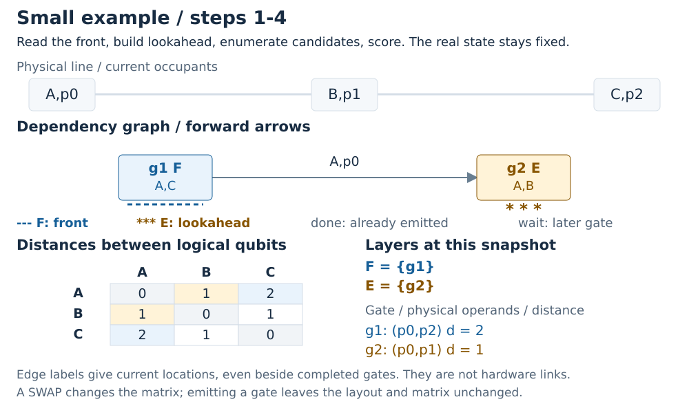

Read the matrix by **logical qubit name**, in the fixed order A, B, C. The
row A, column C entry is 2. The layout strip above the graph tells you why:
A is at p0, C at p2. The highlighted matrix cells are the pairs scored in
F (blue) and E (amber); symmetric cells repeat the same distance.

**Step 3, candidates.** The front qubits sit at p0 and p2. Edges touching
them: `(p0, p1)` and `(p1, p2)`. Two candidates.

**Step 4, score.** For each candidate, imagine applying it and measure the
distances:

| Candidate | Imagined occupants | d(A, C) front | change | d(A, B) lookahead | change |
| --- | --- | --- | --- | --- | --- |
| none (now) | [A, B, C] | 2 | — | 1 | — |
| SWAP(p0, p1) | [B, A, C] | 1 | −1 | 1 | 0 |
| SWAP(p1, p2) | [A, C, B] | 1 | −1 | 2 | +1 |

Both candidates improve the front gate by the same amount, so the front
distance alone cannot choose. The lookahead gate breaks the tie: SWAP(p1, p2)
would pull A and B apart. With the lookahead weight used for a three-qubit
device, `w = 0.5 / 3 ≈ 0.167`:

```text
score(p0, p1) = −1 + 0.167 × 0   = −1.000   <- best
score(p1, p2) = −1 + 0.167 × (+1) = −0.833
```

**Step 5, apply.** Insert `SWAP(p0, p1)`. The occupants become `[B, A, C]`.

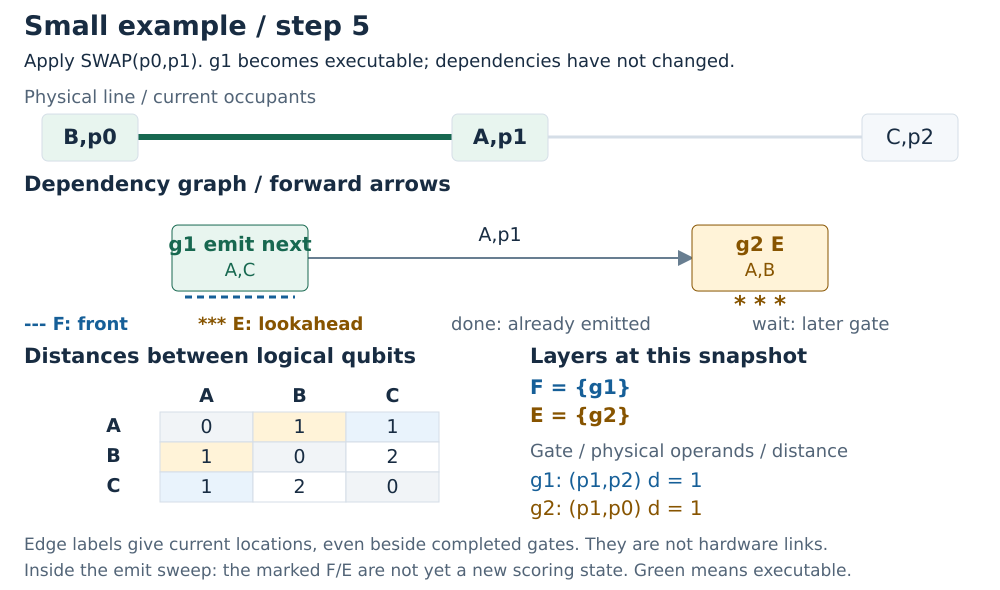

**Step 6, emit.** g1 = CX(A, C) is now on p1 and p2, adjacent: emit it. That
unlocks g2 = CX(A, B), on p1 and p0, adjacent: emit it too.

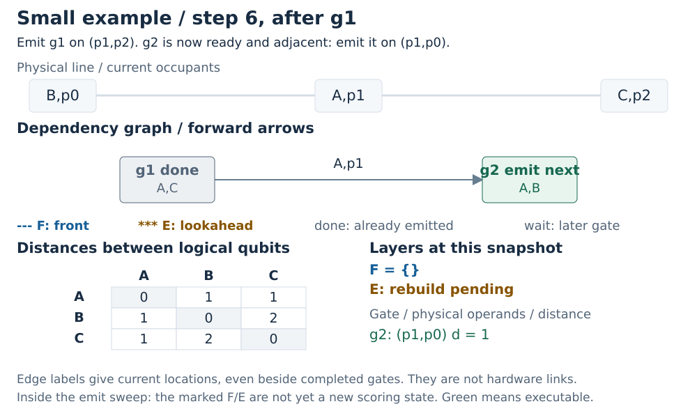

**Step 7.** Nothing is left. Routing is finished with one SWAP:

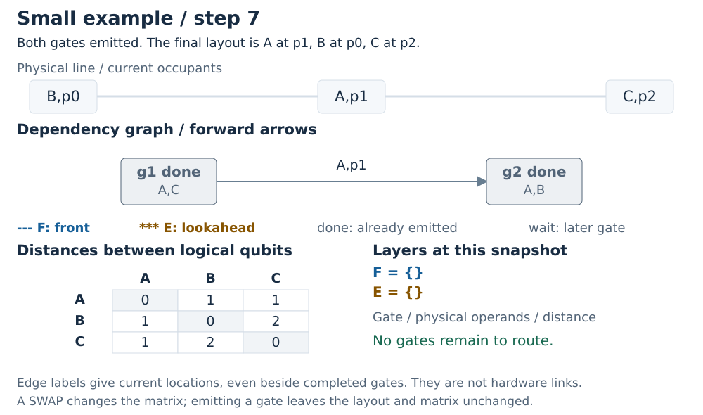

```text
p0: ──X─────────⊕──        X–X  = SWAP(p0, p1)
      │         │          ●/⊕  = CX control / target
p1: ──X────●────●──        g1 = CX on (p1, p2), g2 = CX on (p1, p0)
           │
p2: ───────⊕───────
```

Running this in Qiskit (section 21) produces exactly this circuit.

That is the whole algorithm. The remaining parts add: a slightly larger example
where every decision is tabulated (Part II), the extra terms in the score
(Part III), and how the same routine is reused to choose the initial layout by
running it backward (Part IV).

---

# Part II — Routing, one decision at a time

## 4. The running example

Everything in Parts II–IV uses one circuit on one device. The circuit is the
one the SABRE paper uses to introduce the dependency graph and the front layer
(Figure 4 of Li, Ding and Xie):

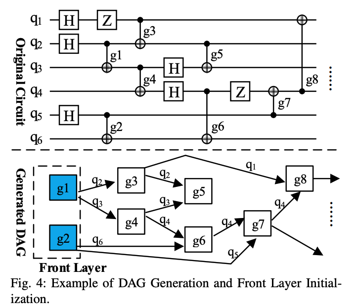

Six program qubits `q1` … `q6`, eight CX gates `g1` … `g8`, and seven
one-qubit gates. The paper's drawing trails off after `g8`; we stop there.
Redrawn with this guide's symbols (● = control, ⊕ = target):

```text
            g1   g2        g3   g4        g5   g6        g7   g8
q1  ────H──────────────Z────●──────────────────────────────────⊕──
                            │                                  │
q2  ────H────●──────────────⊕──────────────●──────────────────────
             │                             │                   │
q3  ─────────⊕───────────────────●────H────⊕──────────────────────
                                 │                             │
q4  ─────────────────────────────⊕────H─────────●────Z────⊕────●──
                                                │         │
q5  ────H─────────●───────────────────────────────────────●───────
                  │                             │
q6  ──────────────⊕─────────────────────────────⊕─────────────────
```

| Gate | Operation | One-qubit gates around it |
| --- | --- | --- |
| g1 | CX(q2, q3) | H on q1, q2 and q5 come first |
| g2 | CX(q5, q6) | |
| g3 | CX(q1, q2) | Z on q1 just before it |
| g4 | CX(q3, q4) | H on q3 and H on q4 just after it |
| g5 | CX(q2, q3) | |
| g6 | CX(q4, q6) | Z on q4 just after it |
| g7 | CX(q5, q4) | control q5, target q4 |
| g8 | CX(q4, q1) | control q4, target q1 |

One-qubit gates never need routing: whatever position a qubit occupies, a gate
on that qubit alone can run there. Section 18 shows how the router folds them
out of the way; until then the dependency graph only needs the CX gates.

Which gates must wait for which? Two gates are ordered only if they share a
qubit:

| Gate | Must wait for | Because |
| --- | --- | --- |
| g1 = CX(q2, q3) | nothing | It is the first CX on both q2 and q3. |
| g2 = CX(q5, q6) | nothing | It is the first CX on both q5 and q6. |
| g3 = CX(q1, q2) | g1 | They share q2. (q1 has no earlier CX.) |
| g4 = CX(q3, q4) | g1 | They share q3. |
| g5 = CX(q2, q3) | g3 **and** g4 | q2 comes from g3, q3 comes from g4. |
| g6 = CX(q4, q6) | g4 **and** g2 | q4 comes from g4, q6 comes from g2. |
| g7 = CX(q5, q4) | g2 **and** g6 | q5 comes from g2, q4 comes from g6. |
| g8 = CX(q4, q1) | g7 **and** g3 | q4 comes from g7, q1 comes from g3. |

As a dependency graph (arrows mean "must come before"). Each edge shows the
shared logical qubit **and its physical location in the starting layout
below**. For example, `g1 -> g3` carries `q2,p1`. The dashed underlines and
asterisks mark F and E, introduced in section 5.

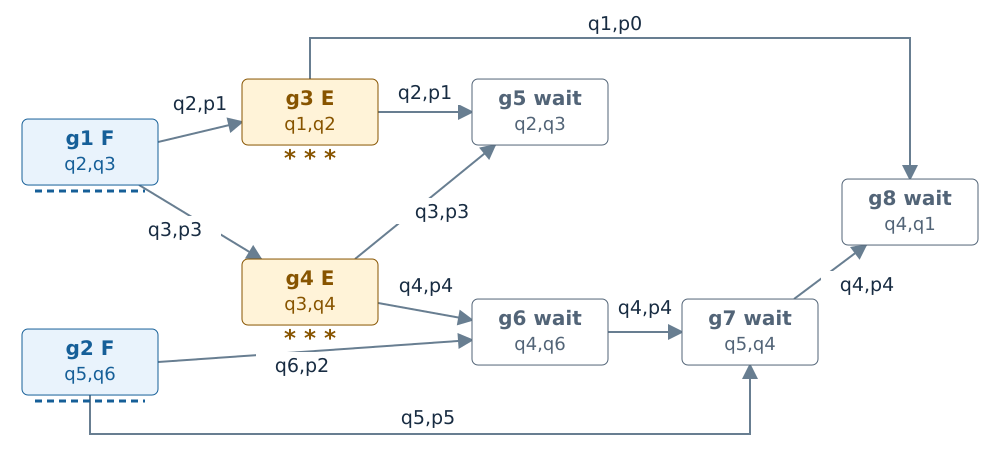

Note that g1 and g2 are written one after the other but act on different
qubits, so there is **no** arrow between them. Likewise g3 and g4: either may
run first.

**The device** is a line of six positions:

```text
p0 ---- p1 ---- p2 ---- p3 ---- p4 ---- p5
```

**Starting occupants:** `[q1, q2, q6, q3, q4, q5]`. Every program qubit sits
at the position with its own number minus one, except q6, which has been
parked between q2 and q3. (The paper leaves the device and the starting layout
open. This choice makes both front-layer gates blocked at the start, so every
part of the algorithm gets exercised. Part IV shows how SABRE would improve on
it.)

The **physical distance matrix** for this device is fixed for the entire
guide. Its row and column names are positions, so `D_phys[pi,pj] = |i-j|`:

| From / to | p0 | p1 | p2 | p3 | p4 | p5 |
| --- | --- | --- | --- | --- | --- | --- |
| p0 | 0 | 1 | 2 | 3 | 4 | 5 |
| p1 | 1 | 0 | 1 | 2 | 3 | 4 |
| p2 | 2 | 1 | 0 | 1 | 2 | 3 |
| p3 | 3 | 2 | 1 | 0 | 1 | 2 |
| p4 | 4 | 3 | 2 | 1 | 0 | 1 |
| p5 | 5 | 4 | 3 | 2 | 1 | 0 |

Every step below shows this same information **indexed by logical qubits**:
`D_layout[qa,qb] = D_phys[layout(qa),layout(qb)]`. Rows and columns stay in
the order q1, q2, ..., q6; the values change when their positions change.
For example, initially `D_layout[q2,q3] = D_phys[p1,p3] = 2`.
After SWAP(p2,p3), it becomes `D_phys[p1,p2] = 1`. The chip did not change;
q3 moved. A gate emission changes neither matrix.

With those occupants:

| Gate | Positions now | Distance | Adjacent? |
| --- | --- | --- | --- |
| g1 = CX(q2, q3) | p1, p3 | 2 | No |
| g2 = CX(q5, q6) | p5, p2 | 3 | No |
| g3 = CX(q1, q2) | p0, p1 | 1 | Yes |
| g4 = CX(q3, q4) | p3, p4 | 1 | Yes |
| g5 = CX(q2, q3) | p1, p3 | 2 | No |
| g6 = CX(q4, q6) | p4, p2 | 2 | No |
| g7 = CX(q5, q4) | p5, p4 | 1 | Yes |
| g8 = CX(q4, q1) | p4, p0 | 4 | No |

g3, g4 and g7 are adjacent, but none of them can run yet: each is waiting for
g1 or g2. That distinction is the subject of the next section.

## 5. Ready versus adjacent: the front layer and the lookahead layer

A two-qubit gate can be emitted only when **both** of these hold:

1. **Ready:** every gate it depends on has already been emitted.
2. **Adjacent:** its two qubits currently sit on connected positions.

Readiness comes from the program; adjacency comes from the layout. SWAPs
change adjacency. Nothing changes readiness except emitting the predecessors.
("Emitting" a gate means writing it into the output circuit on the physical
positions its qubits occupy at that moment. In circuit drawings a physical
position is a horizontal **wire**, so "wire" and "position" are used
interchangeably below.)

### How readiness is tracked

Give each gate a counter: "how many of my predecessors are still not done".
The columns below follow the order in which the gates are actually emitted in
sections 6 and 7:

| Gate | At start | After g1 | After g3 | After g2, g4 | After g6, g5 | After g7 |
| --- | --- | --- | --- | --- | --- | --- |
| g1 | 0 | done | done | done | done | done |
| g2 | 0 | 0 | 0 | done | done | done |
| g3 | 1 | 0 → ready | done | done | done | done |
| g4 | 1 | 0 → ready | 0 | done | done | done |
| g5 | 2 | 2 | 1 | 0 → ready | done | done |
| g6 | 2 | 2 | 2 | 0 → ready | done | done |
| g7 | 2 | 2 | 2 | 1 | 0 → ready | done |
| g8 | 2 | 2 | 1 | 1 | 1 | 0 → ready |

A gate with counter 0 is ready. Emitting a gate decrements the counters of
its successors. (The code counts dependency *edges*, and two gates can be
joined by more than one edge when they share two wires, but the idea is the
same.)

### The front layer

The **front layer**, written `F`, is the set of gates that are ready but
**not** adjacent. These are the gates that routing must do something about.

Gates that are ready *and* adjacent never sit in `F`: the router emits them
immediately, then checks whether that made anything else ready, and keeps
going. Only when every ready gate is blocked does it stop and start choosing
SWAPs. This "emit everything you can" sweep is why a circuit with thousands of
gates may need only a few hundred SWAP decisions.

At the start of our example: g1 and g2 are ready, and neither is adjacent.
`F = {g1, g2}`. This is the front layer the figure highlights. (The paper
defines `F` as *all* ready gates; Qiskit's `F` holds only the ready gates that
are blocked, because the others are emitted on the spot. At the start of this
example the two definitions agree.)

### The lookahead layer

The **lookahead layer**, written `E`, answers: "if the whole front layer were
done, which two-qubit gates would become ready?" To compute it, the router
copies the readiness counters, pretends every front gate is done, and collects
the gates whose copied counter reaches 0. Nothing is actually emitted; the real
counters are untouched.

At the start: pretending g1 and g2 are done makes g3 and g4 ready.
`E = {g3, g4}`. g5 is not in `E`, because it also waits for g3 and g4, which
are not done even in the pretend world; the same goes for g6, g7 and g8.

Three things about `E` are worth noticing:

- It can contain gates that are **already adjacent** (g3 and g4 both are).
  That is useful: a SWAP that pulled them apart would create work later, and
  the score should see that.
- The named `lookahead` and `decay` modes in this checkout use **one**
  lookahead layer. The Rust code supports more (each with its own weight), but
  the Python passes that call it do not use them.
- The code maintains `E` incrementally rather than recomputing it, and the
  incremental update has one gap: a gate whose last missing predecessor is
  emitted *during* an emit sweep, while another of its predecessors is sitting
  in `F`, is not added to `E`. Section 6.5 shows the one place this happens in
  our example (g5 after the first decision). It changes no decision there, but
  if you recompute `E` by hand from the definition you will see one more gate
  than the code does.

### Reading a state snapshot

Read each figure from top to bottom: **layout, dependency graph, layers,
distance matrix**. The graph keeps every gate in the same place across the
walkthrough, so it is easy to see what changed. One-qubit gates remain
omitted from this CX dependency graph.

| Mark | Meaning |
| --- | --- |
| `F` in a node, dashed line underneath | Ready but blocked; the gates whose distances drive the next SWAP. |
| `E` in a node, `***` underneath | Lookahead; scored but not permitted to run yet. |
| `done`, grey node | Already emitted in this pass; kept visible to preserve the dependency picture. |
| `wait`, plain node | Still waiting for predecessors, outside the current F and E. |
| `emit next`, green node | Ready and adjacent inside an emission sweep. No new SWAP is needed for it. |
| Green hardware edge and occupants | The SWAP just applied; green graph nodes instead mean executable gates. |
| Blue / amber matrix cells | The logical pairs currently scored in F / E. |

**Timing of the snapshots.** State S0 is before decision 1. State S1 is
after decision 1 **and its full emit sweep**, hence before decision 2;
the same convention continues through S6. Separate intermediate snapshots
inside decision 1 show why "after the SWAP" and "after the emit sweep" are
different moments. In an intermediate snapshot, a previously blocked F gate
can be adjacent and awaiting immediate emission; no candidate is scored in
that temporary state.

**How to read a dependency edge.** `g1 -> g3` labelled `q2,p1` says that g3
waits for g1 on q2, and q2 is **currently** at p1. It is not a device
connection, and is not a record of where g1 ran in the past. Labels beside
grey nodes also use the current layout. Use the emission tables for the
physical operands at the time a gate was emitted.

The state before the first decision is S0. H(q1), Z(q1), H(q2), and H(q5)
have already been emitted; no CX has been emitted yet.

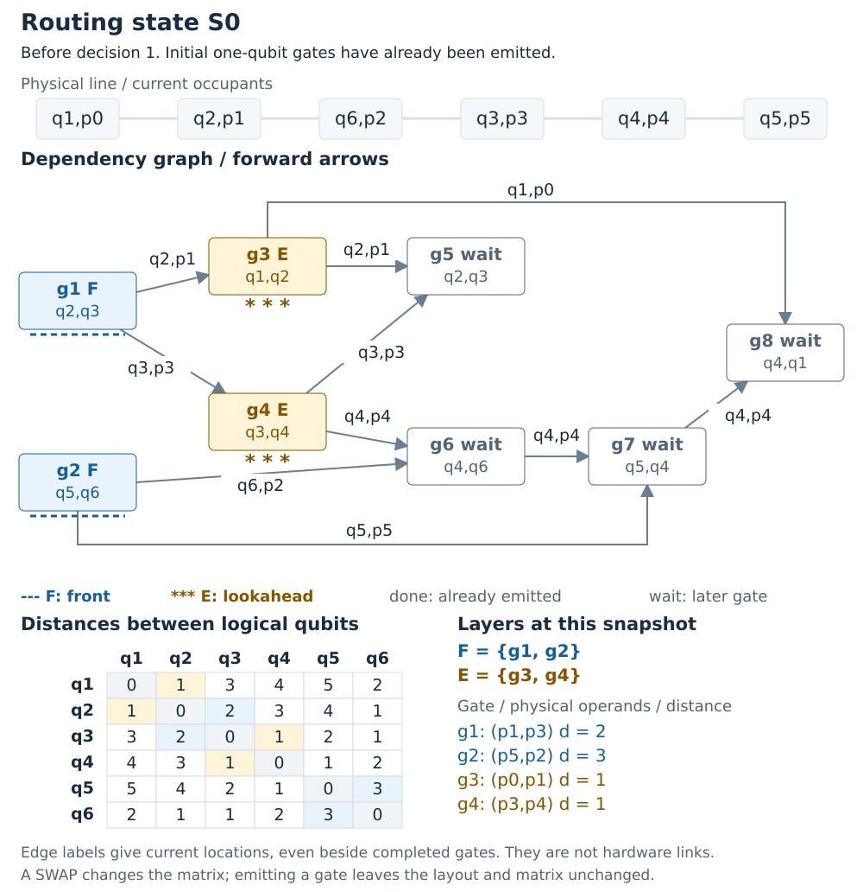

**A quick reading check.** g3 has distance 1, but its predecessor g1 is
not grey: g3 cannot run. g1 has no unfinished predecessor, but distance 2:
it needs routing. These are two different reasons for a gate to wait.

## 6. The first decision, step by step

### 6.1 Which SWAPs are candidates

**Rule.** A candidate is any hardware edge that has at least one endpoint
occupied by a qubit of a front-layer gate. An edge touching two such qubits is
listed once.

**Why this rule.** A SWAP that touches no front qubit cannot change any front
distance in this step, so it cannot help now. Restricting candidates this way
keeps every decision cheap: there are at most (2 × number of blocked gates ×
the largest number of neighbors any position has) candidates, however many
edges the device has.

**Example.** The front gates use q2 (at p1), q3 (at p3), q5 (at p5) and q6
(at p2):

| Front position | Its neighbors | Candidate edges |
| --- | --- | --- |
| p1, holding q2 | p0, p2 | (p0, p1), (p1, p2) |
| p3, holding q3 | p2, p4 | (p2, p3), (p3, p4) |
| p5, holding q5 | p4 | (p4, p5) |
| p2, holding q6 | p1, p3 | (p1, p2), (p2, p3): already listed |

Five candidates: `(p0, p1)`, `(p1, p2)`, `(p2, p3)`, `(p3, p4)`, `(p4, p5)`.
On this small device that happens to be every edge; on a larger one, edges far
from the front qubits would be left out.

Not a candidate: `(p1, p3)`, because it is not a hardware edge. A SWAP can
only be applied to connected positions.

### 6.2 Score by front-layer distance

**Rule.** For each candidate, imagine applying it to the *current* layout
(the candidates are alternatives, not a sequence), and compute

```text
ΔD_F = (sum of front distances after the SWAP) − (sum of front distances now)
```

Smaller is better. A negative value is an improvement.

**Example.** The front has two gates, so each candidate is judged on the sum
of both distances:

| Candidate | Imagined occupants [p0 … p5] | d(q2, q3) | d(q5, q6) | ΔD_F |
| --- | --- | --- | --- | --- |
| none (now) | [q1, q2, q6, q3, q4, q5] | 2 | 3 | — |
| SWAP(p0, p1) | [q2, q1, q6, q3, q4, q5] | 3 | 3 | +1 |
| SWAP(p1, p2) | [q1, q6, q2, q3, q4, q5] | 1 | 4 | (1 − 2) + (4 − 3) = 0 |
| SWAP(p2, p3) | [q1, q2, q3, q6, q4, q5] | 1 | 2 | (1 − 2) + (2 − 3) = **−2** |
| SWAP(p3, p4) | [q1, q2, q6, q4, q3, q5] | 3 | 3 | +1 |
| SWAP(p4, p5) | [q1, q2, q6, q3, q5, q4] | 2 | 2 | −1 |

SWAP(p2, p3) is the clear winner: it moves q3 next to q2 *and* moves q6 one
step toward q5. One SWAP, two gates helped. Compare SWAP(p1, p2), which also
makes g1 adjacent but pushes q6 one step further from q5, for a net change of
zero. Scoring the whole front rather than one gate at a time is what lets
SABRE find moves like SWAP(p2, p3).

The code (`Layer::score`) does not recompute every distance. Only the two
swapped positions move, so only their partners' distances can change; it adds
up just those changes. That is the "delta" the name `ΔD_F` refers to.

### 6.3 Add the lookahead

**Rule.** Compute the same change for the lookahead layer, `ΔD_E`, and add a
small multiple of it:

```text
score = ΔD_F + w × ΔD_E,        w = 0.5 / (number of physical qubits)
```

The weight is small on purpose: the front layer must win when they disagree,
and lookahead should only separate options that are equally good for the front.
On our six-position device `w = 0.5 / 6 = 1/12 ≈ 0.0833`.

**Example.** The lookahead gates are g3 = CX(q1, q2) and g4 = CX(q3, q4). Now
their distances sum to `1 + 1 = 2`.

| Candidate | Imagined occupants | d(q1, q2) | d(q3, q4) | ΔD_E | ΔD_F | score = ΔD_F + ΔD_E / 12 |
| --- | --- | --- | --- | --- | --- | --- |
| SWAP(p0, p1) | [q2, q1, q6, q3, q4, q5] | 1 | 1 | 0 | +1 | +1.0000 |
| SWAP(p1, p2) | [q1, q6, q2, q3, q4, q5] | 2 | 1 | +1 | 0 | +0.0833 |
| SWAP(p2, p3) | [q1, q2, q3, q6, q4, q5] | 1 | 2 | +1 | −2 | **−1.9167** |
| SWAP(p3, p4) | [q1, q2, q6, q4, q3, q5] | 1 | 1 | 0 | +1 | +1.0000 |
| SWAP(p4, p5) | [q1, q2, q6, q3, q5, q4] | 1 | 2 | +1 | −1 | −0.9167 |

**Winner: SWAP(p2, p3).** The lookahead does not change the ranking here; it
only records that the winner has a cost, namely moving q3 one step away from
q4, which g4 will need later. A front gain of two steps outweighs a lookahead
loss of one twelfth. Part III's extra terms are all zero at this point (nothing
has been emitted, every wire is idle), so classic SABRE and this checkout make
the same choice.

This is what lookahead is for: choose among equally good immediate moves using
a glimpse of what comes next. It does not plan the whole future and it does
not guarantee the globally best route; it is a cheap, informed preference.

### 6.4 Apply the winner

Only the winning SWAP is applied. The other candidates were hypothetical.

```text
Insert SWAP(p2, p3) into the output.

Positions:   p0 ---- p1 ---- p2 ---- p3 ---- p4 ---- p5
Before:       q1      q2      q6      q3      q4      q5
After:        q1      q2      q3      q6      q4      q5
```

What changed and what did not:

| Thing | Changed? |
| --- | --- |
| Hardware graph, distance table | No, never. |
| Layout (who is where) | Yes: q3 → p2, q6 → p3. |
| The gates still to route | No, but their physical positions must be re-read from the new layout. |
| Readiness counters | No. A SWAP emits no program gate. |

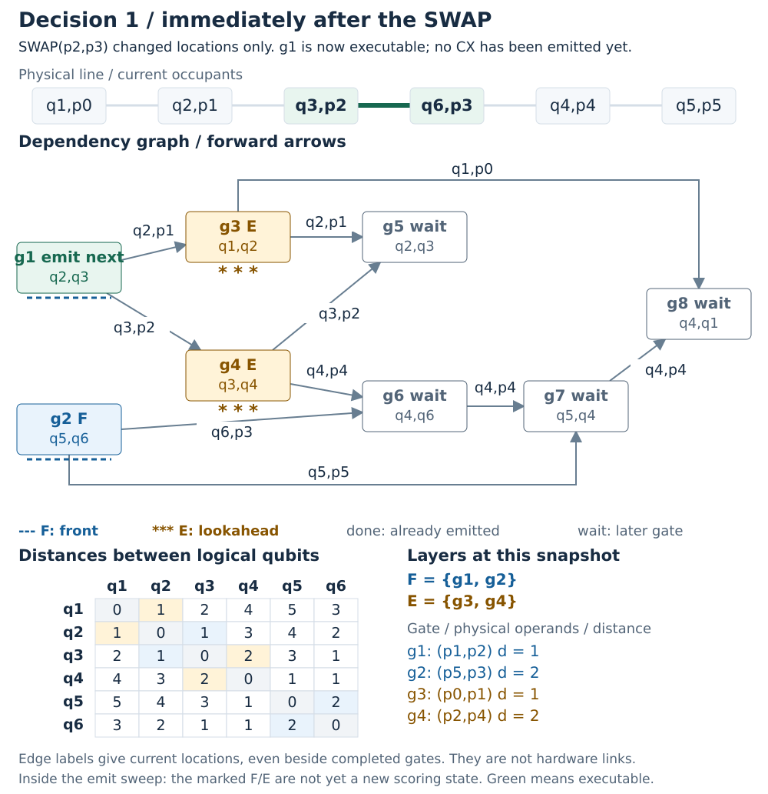

**Read the score directly from the two matrices.** In S0 the front pairs
had distances `D[q2,q3] + D[q5,q6] = 2 + 3 = 5`. In this intermediate
snapshot they have `1 + 2 = 3`, so `ΔD_F = 3 - 5 = -2`. The lookahead
pairs change from `1 + 1 = 2` to `1 + 2 = 3`, so `ΔD_E = +1`.
Use the **same F and E before and after a hypothetical SWAP** for this
calculation; do not substitute the new layers produced by emitting gates.

### 6.5 Emit what is now possible

g1 = CX(q2, q3): q2 at p1, q3 at p2, adjacent. Emit it as `CX(p1, p2)`. Its
counter-decrement makes g3 and g4 ready:

| Newly ready gate | Positions under [q1, q2, q3, q6, q4, q5] | Adjacent? | Action |
| --- | --- | --- | --- |
| g3 = CX(q1, q2) | p0, p1 | Yes | Emit as CX(p0, p1). |
| g4 = CX(q3, q4) | p2, p4 | No, distance 2 | Put in the front layer. |
| g5 = CX(q2, q3), ready after g3 and g4 | — | — | Still waits for g4. |

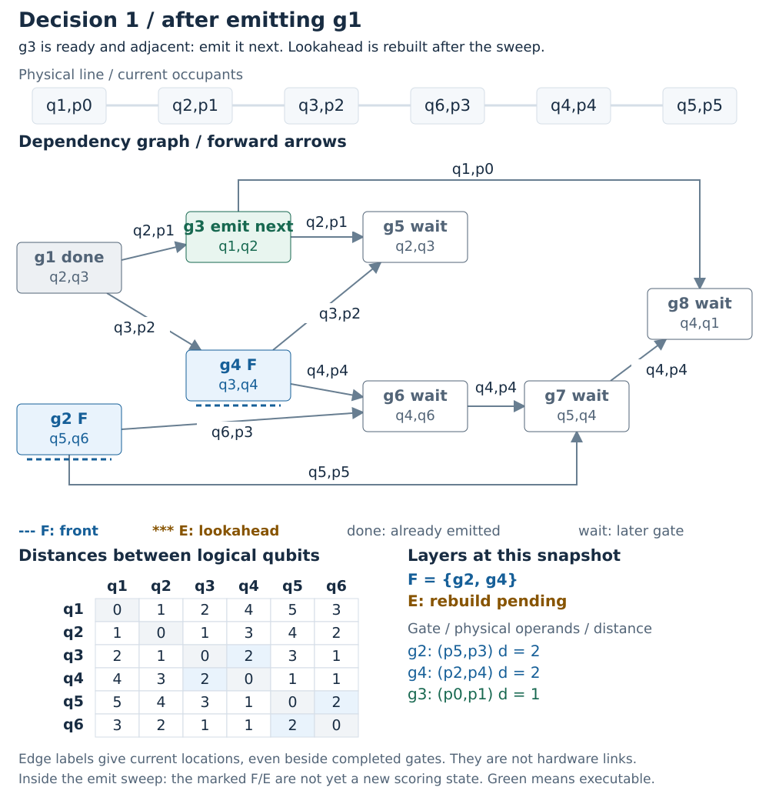

g2 is still blocked (q5 at p5, q6 at p3, distance 2), so the front layer now
holds two gates again: `F = {g2, g4}`.

The lookahead layer is rebuilt. Pretending g2 and g4 are done makes g6 ready
(it waited for g4 and g2), so `E = {g6}`. By the definition, g5 should be
there too: it waits for g3, which has just been emitted, and g4, which is in
`F`. This is the gap mentioned in section 5. The code added g5's last missing
predecessor to the "done" side during the sweep that emitted g3, and the
incremental update only adds a gate to `E` when the predecessor that completed
its count is one that *stayed* in `F`. So the code's `E` is `{g6}`. For the
next decision this makes no difference: with g5 included, SWAP(p2, p3) would
score one twelfth worse and nothing else would change, and SWAP(p2, p3) does
not win anyway.

State S1 is after the first decision and the complete emission sweep:

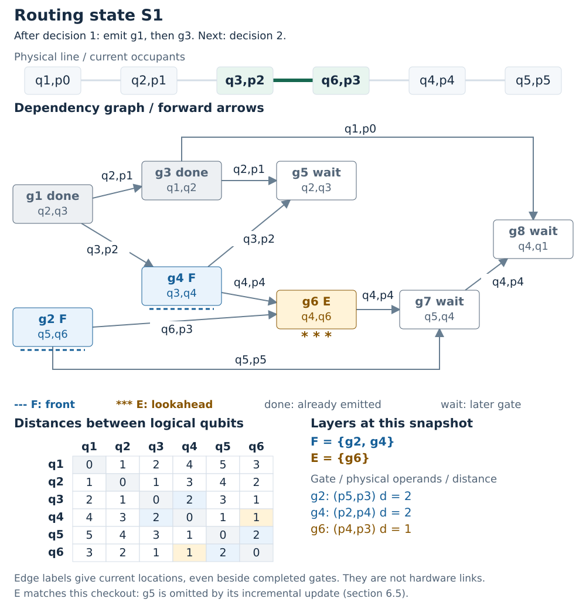

Notice that the front layer did not simply inherit the old lookahead layer.
g3 was adjacent, so it was emitted straight away; g4 was not, so it joined g2
in the front. The lookahead layer was then rebuilt from the new front.

## 7. Finishing the circuit: decisions 2 to 6

### Decision 2

**Starting snapshot: S1 above.**

Front: g2 with q5 at p5 and q6 at p3; g4 with q3 at p2 and q4 at p4. Every
position from p2 to p5 holds a front qubit, so the candidates are the edges
touching any of them: `(p1, p2)`, `(p2, p3)`, `(p3, p4)` and `(p4, p5)`. The
edge `(p0, p1)` touches no front qubit and is not considered. Lookahead:
g6 = CX(q4, q6), with q4 at p4 and q6 at p3, distance 1.

| Candidate | Imagined occupants | d(q5, q6) | d(q3, q4) | ΔD_F | d(q4, q6) | ΔD_E | score |
| --- | --- | --- | --- | --- | --- | --- | --- |
| SWAP(p1, p2) | [q1, q3, q2, q6, q4, q5] | 2 | 3 | +1 | 1 | 0 | +1.0000 |
| SWAP(p2, p3) | [q1, q2, q6, q3, q4, q5] | 3 | 1 | 0 | 2 | +1 | +0.0833 |
| SWAP(p3, p4) | [q1, q2, q3, q4, q6, q5] | 1 | 1 | **−2** | 1 | 0 | **−2.0000** |
| SWAP(p4, p5) | [q1, q2, q3, q6, q5, q4] | 1 | 3 | 0 | 2 | +1 | +0.0833 |

**Winner: SWAP(p3, p4)**, and again one SWAP serves both front gates: it
carries q6 to p4, next to q5, and q4 to p3, next to q3. (This checkout also
adds ready-time penalties of at most 0.0001 here, section 12; they do not
change the order.)

After the SWAP the occupants are `[q1, q2, q3, q4, q6, q5]`, and the emit
sweep is the longest of the whole run:

| Gate | Positions | Adjacent? | Action |
| --- | --- | --- | --- |
| g2 = CX(q5, q6) | p5, p4 | Yes | Emit as CX(p5, p4). |
| g4 = CX(q3, q4) | p2, p3 | Yes | Emit as CX(p2, p3), followed by H on p2 and H on p3 (the one-qubit gates that come after g4 on q3 and q4). |
| g6 = CX(q4, q6), ready after g4 and g2 | p3, p4 | Yes | Emit as CX(p3, p4), followed by Z on p3. |
| g5 = CX(q2, q3), ready after g3 and g4 | p1, p2 | Yes | Emit as CX(p1, p2). |
| g7 = CX(q5, q4), ready after g2 and g6 | p5, p3 | No, distance 2 | Put in the front layer. |
| g8 = CX(q4, q1), ready after g7 and g3 | — | — | Still waits for g7. |

Four CX gates and three one-qubit gates come out after a single SWAP. This is
the "emit everything you can" sweep of section 5 doing its job.

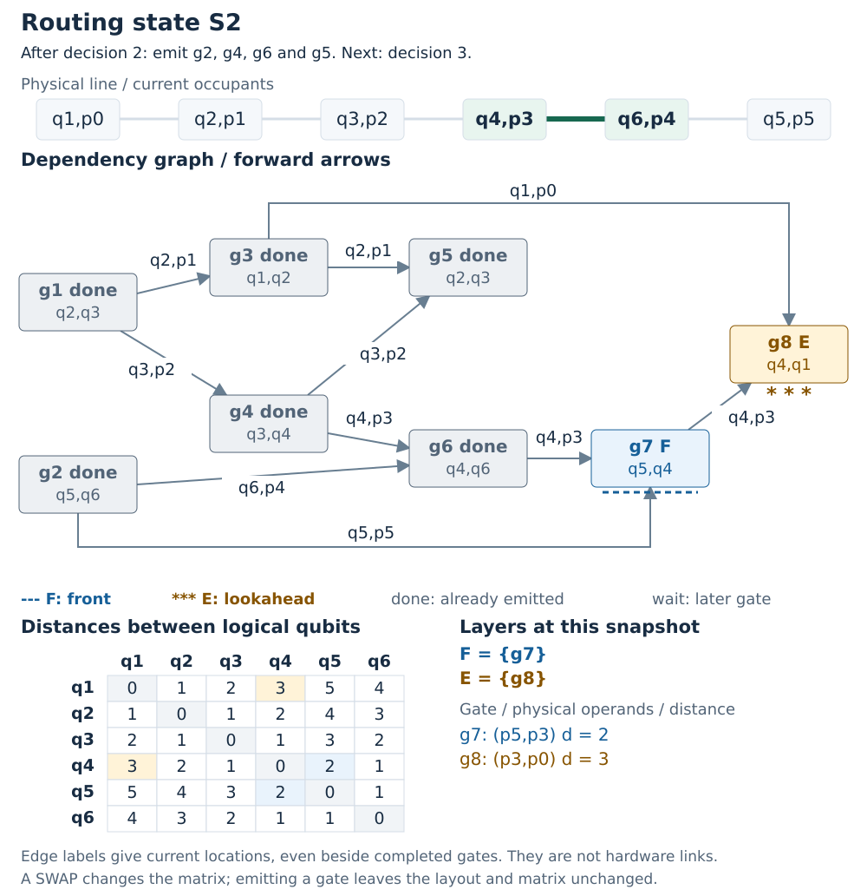

### Decision 3

**Starting snapshot: S2 above.**

Front: g7 with q5 at p5 and q4 at p3. Candidates: edges touching p5 or p3,
which are `(p4, p5)`, `(p2, p3)` and `(p3, p4)`. Lookahead: g8, with q4 at
p3 and q1 at p0, distance 3.

| Candidate | Imagined occupants | d(q5, q4) | ΔD_F | d(q4, q1) | ΔD_E | score (classic SABRE) |
| --- | --- | --- | --- | --- | --- | --- |
| SWAP(p2, p3) | [q1, q2, q4, q3, q6, q5] | 3 | +1 | 2 | −1 | +0.9167 |
| SWAP(p3, p4) | [q1, q2, q3, q6, q4, q5] | 1 | −1 | 4 | +1 | −0.9167 |
| SWAP(p4, p5) | [q1, q2, q3, q4, q5, q6] | 1 | −1 | 3 | 0 | **−1.0000** |

Two candidates make g7 adjacent. Classic SABRE prefers SWAP(p4, p5), which
moves q5 toward q4 and leaves q4 where it is, over SWAP(p3, p4), which moves
q4 one step further from q1 and so costs one twelfth on the lookahead.

**This checkout chooses SWAP(p3, p4) instead.** The gate emitted immediately
before on that same pair of wires was g6 = CX(p3, p4), and a SWAP that
directly follows a CX on the same pair is cheaper than a SWAP elsewhere: a
later optimization pass merges the two into two CX gates instead of four. The
*fusion credit* of section 11 gives SWAP(p3, p4) a bonus of −2/3, which is
much more than the one twelfth it loses on the lookahead. The ready-time
penalties of section 12 are equal for the two and do not matter. Take the
numbers on trust for now; section 11 works them out. This is the one decision
in the run where the extra terms do more than break a tie: they overturn the
classic ranking. We follow it.

After SWAP(p3, p4) the occupants are `[q1, q2, q3, q6, q4, q5]`. Yes, this
undoes the previous SWAP(p3, p4) as far as the layout is concerned, but the
computation is **not** undone: g2, g4, g6 and g5 were all emitted between the
two SWAPs, and g6 used exactly that pair of wires. g7 = CX(q5, q4) is now on
p5 and p4, adjacent, and is emitted as `CX(p5, p4)`. That makes g8 ready: q4
at p4 and q1 at p0, distance 4, so it goes into the front layer. Nothing comes
after g8, so `E` is empty.

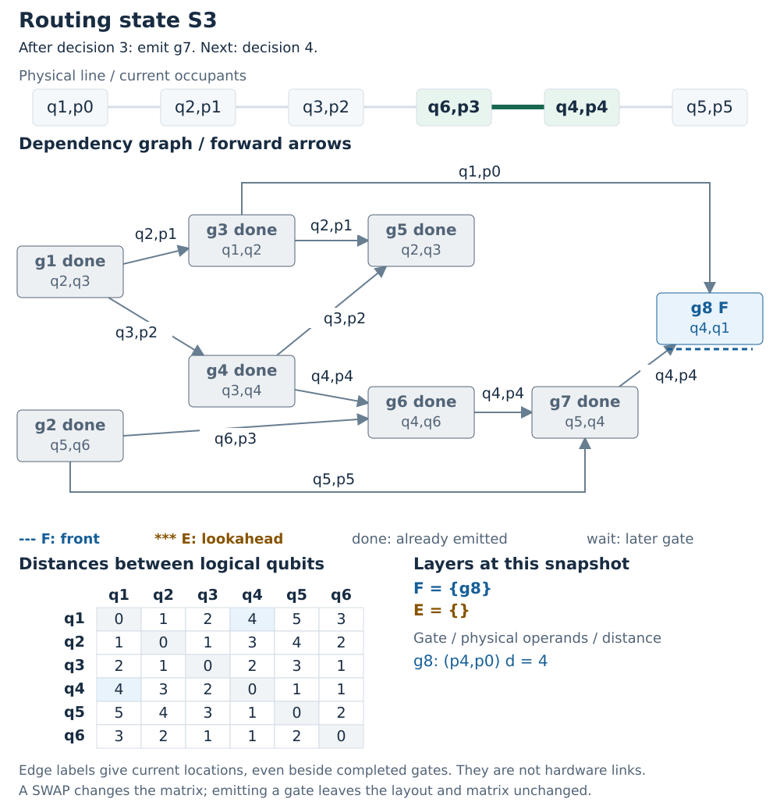

**Same layout, different progress.** S3 has the same occupants and matrix
as S1, but five more gates are grey. A layout alone is not the routing state:
you also need to know which gates are done and which remain in F and E.

### Decisions 4, 5 and 6

g8 needs three more SWAPs: q4 and q1 are four steps apart, and a SWAP moves
one of them one step. With `E` empty the lookahead term is zero throughout,
and at every one of the three decisions two candidates tie on distance. In
classic SABRE each would be a coin flip. This checkout breaks all three with
the ready-time penalty of section 12, which prefers the SWAP whose wires have
been idle longest; section 12 shows the numbers. Here is the distance picture.

**Decision 4.** q4 at p4, q1 at p0. Candidates: `(p3, p4)`, `(p4, p5)` and
`(p0, p1)`.

| Candidate | Moves | d(q4, q1) | ΔD_F | Decided by |
| --- | --- | --- | --- | --- |
| SWAP(p0, p1) | q1 → p1 | 3 | −1 | **wins**: p0 and p1 have been idle since g3 |
| SWAP(p3, p4) | q4 → p3 | 3 | −1 | loses: p3 and p4 were just used by the last SWAP and g7 |
| SWAP(p4, p5) | q4 → p5 | 5 | +1 | never in contention (its fusion credit after g7 only softens +1 to +1/3) |

Occupants become `[q2, q1, q3, q6, q4, q5]`. g8 is still blocked (distance
3), so no gate is emitted and the search continues from the same front.

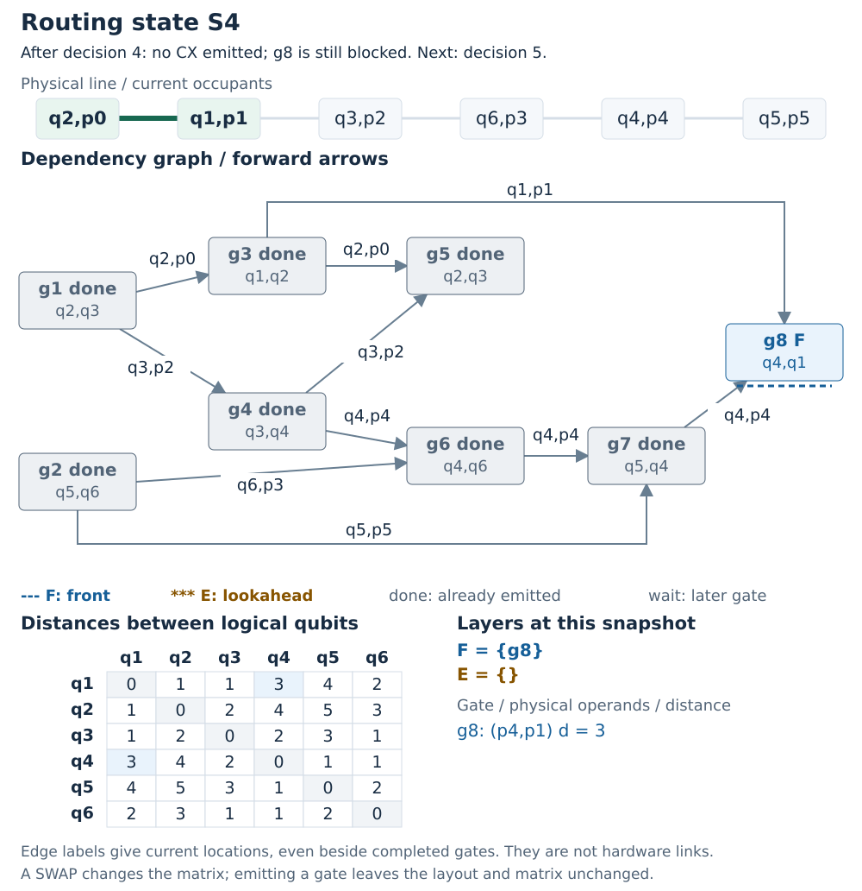

**Decision 5.** q4 at p4, q1 at p1. Candidates: `(p3, p4)`, `(p4, p5)`,
`(p0, p1)` and `(p1, p2)`.

| Candidate | Moves | d(q4, q1) | ΔD_F | Decided by |
| --- | --- | --- | --- | --- |
| SWAP(p1, p2) | q1 → p2 | 2 | −1 | **wins**: p2 has been idle since g5 |
| SWAP(p3, p4) | q4 → p3 | 2 | −1 | loses on ready time, by a hair |
| SWAP(p0, p1) | q1 back to p0 | 4 | +1 | |
| SWAP(p4, p5) | q4 → p5 | 4 | +1 (+1/3 after credit) | |

Occupants become `[q2, q3, q1, q6, q4, q5]`. Distance 2: still blocked.

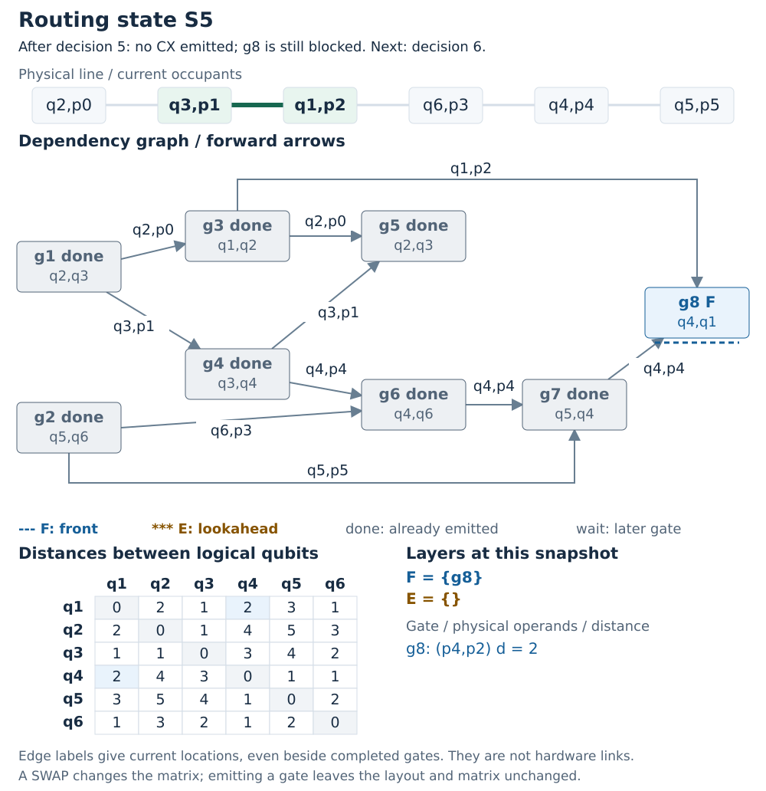

**Decision 6.** q4 at p4, q1 at p2. Candidates: `(p3, p4)`, `(p4, p5)`,
`(p1, p2)` and `(p2, p3)`.

| Candidate | Moves | d(q4, q1) | ΔD_F | Decided by |
| --- | --- | --- | --- | --- |
| SWAP(p3, p4) | q4 → p3 | 1 | −1 | **wins**: now p3, p4 are the fresher pair |
| SWAP(p2, p3) | q1 → p3 | 1 | −1 | loses: p2 was just used by SWAP(p1, p2) |
| SWAP(p1, p2) | q1 back to p1 | 3 | +1 | |
| SWAP(p4, p5) | q4 → p5 | 3 | +1 (+1/3 after credit) | |

Occupants become `[q2, q3, q1, q4, q6, q5]`. q4 at p3 and q1 at p2 are
adjacent, and g8 is emitted as `CX(p3, p2)`. The front layer is empty, so
routing is finished.

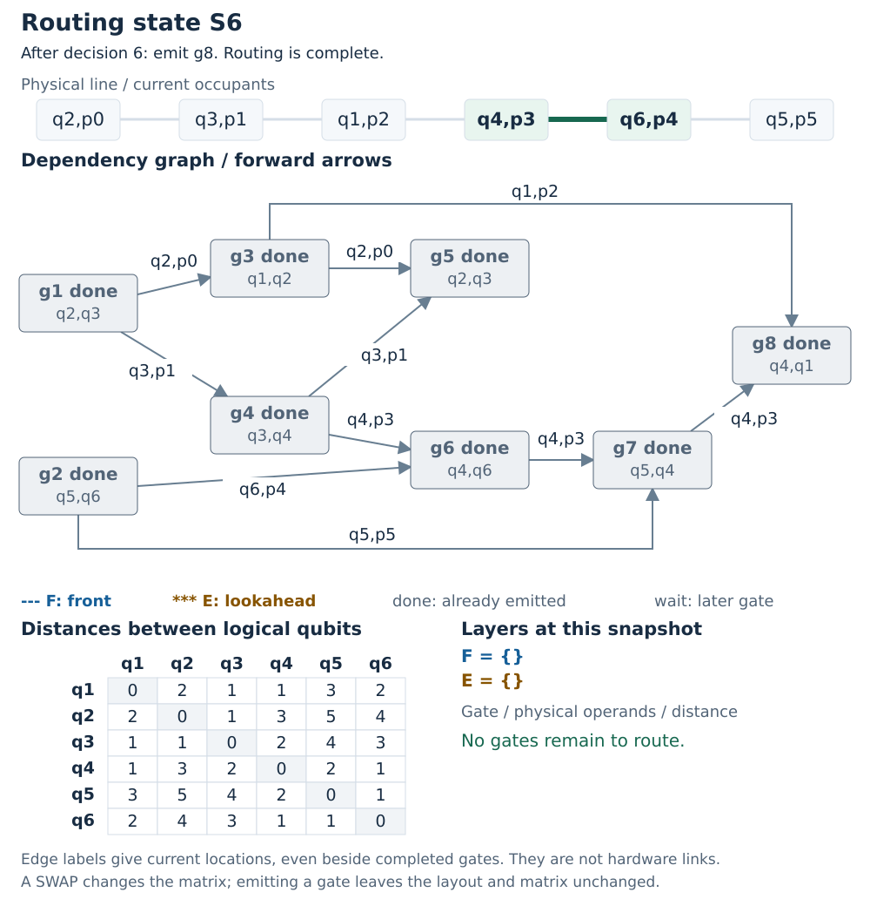

The pattern is worth a second look. q1 walked two steps to the right on wires
that had been idle since early in the circuit, and q4 took one step to the
left at the end. Each of those SWAPs can start as soon as its own wires are
free, rather than queueing behind the busy wires p3–p5, which is exactly what
the ready-time term is designed to encourage.

### The complete route

The state sequence is `S0 -> S1 -> S2 -> S3 -> S4 -> S5 -> S6`.
Each arrow is one chosen SWAP followed by every gate it enables. The two
arrows into S4 and S5 emit no program gate.

| Event | Occupants afterward | Emitted | Still blocked |
| --- | --- | --- | --- |
| Start | [q1, q2, q6, q3, q4, q5] | H(p0), Z(p0), H(p1), H(p5) | g1 at distance 2, g2 at distance 3 |
| Decision 1 | [q1, q2, q3, q6, q4, q5] | SWAP(p2, p3) | g2 at distance 2 |
| Emit | [q1, q2, q3, q6, q4, q5] | CX(p1, p2) = g1, CX(p0, p1) = g3 | g4 at distance 2 joins g2 |
| Decision 2 | [q1, q2, q3, q4, q6, q5] | SWAP(p3, p4) | nothing in front of g2 and g4 |
| Emit | [q1, q2, q3, q4, q6, q5] | CX(p5, p4) = g2; CX(p2, p3) = g4, H(p2), H(p3); CX(p3, p4) = g6, Z(p3); CX(p1, p2) = g5 | g7 at distance 2 |
| Decision 3 | [q1, q2, q3, q6, q4, q5] | SWAP(p3, p4) | nothing in front of g7 |
| Emit | [q1, q2, q3, q6, q4, q5] | CX(p5, p4) = g7 | g8 at distance 4 |
| Decision 4 | [q2, q1, q3, q6, q4, q5] | SWAP(p0, p1) | g8 at distance 3 |
| Decision 5 | [q2, q3, q1, q6, q4, q5] | SWAP(p1, p2) | g8 at distance 2 |
| Decision 6 | [q2, q3, q1, q4, q6, q5] | SWAP(p3, p4) | nothing |
| Emit | [q2, q3, q1, q4, q6, q5] | CX(p3, p2) = g8 | finished |

The physical output circuit (X–X = SWAP, ● = control, ⊕ = target):

```text
                  g1  g3      g2  g4      g6      g5      g7              g8
p0  ───H───Z───────────●───────────────────────────────────────X──────────────
                       │                                       │
p1  ───H───────────●───⊕───────────────────────────●───────────X───X──────────
                   │                               │               │
p2  ───────────X───⊕───────────────●───H───────────⊕───────────────X───────⊕──
               │                   │                                       │
p3  ───────────X───────────X───────⊕───H───●───Z───────X───────────────X───●──
                           │               │           │               │
p4  ───────────────────────X───⊕───────────⊕───────────X───⊕───────────X──────
                               │                           │
p5  ───H───────────────────────●───────────────────────────●──────────────────
```

Six SWAPs, eight CX gates. Expanding each SWAP into three CX gives 26 CX
gates before any optimization; later passes can reduce that (section 11).

**Final layout:** `q1 → p2, q2 → p0, q3 → p1, q4 → p3, q5 → p5, q6 → p4`,
that is, occupants `[q2, q3, q1, q4, q6, q5]`. The output does not swap
everyone back to where they started. Qiskit records this final layout so that
later passes and measurement results are interpreted correctly: a measurement
of program qubit q1 must read position **p2**.

**Why this route is legal** (worth checking for any hand-worked example):

1. Every SWAP and every CX uses a hardware edge.
2. Every CX acts on the positions that hold its program qubits *at that
   moment*, with control and target in the right order.
3. No dependency is violated: g1 before g3 and g4; g3 and g4 before g5; g2 and
   g4 before g6; g2 and g6 before g7; g7 and g3 before g8. The one-qubit gates
   stay on their own qubit's wire and in their original order relative to the
   CX gates on that qubit.
4. The final layout accounts for every SWAP.

A route can be legal and still wasteful. Legality is a correctness property;
SWAP count and depth are quality properties.

## 8. Decay: spread the SWAPs over different wires

**The idea:** when two candidate SWAPs make similar progress, prefer the one
whose physical wires have not just been used by another SWAP. Distance and
lookahead describe where the qubits are; **decay** adds a small memory of how
they got there. A recently used wire makes a candidate slightly more expensive.

This section first explains decay with only the classic distance and lookahead
terms. Section 8.6 then adds this checkout's fusion and ready-time terms to
reproduce its exact choice. The increment `0.001`, reset interval `5`, and
weight `w = 0.5 / number of physical qubits` below are this checkout's Python
wrappers' decay configuration (section 13), not universal constants of SABRE.

### 8.1 What does "spread over different wires" mean?

A **wire** here means a fixed physical position, such as p1, not whichever
program qubit currently occupies it. **SWAPs that share a physical qubit must
run one after another; SWAPs on separate qubits can run simultaneously.**
Decay encourages choices that allow this parallel execution.

Consider a small example with four physical positions and a gate needed
between program qubits **A and B**:

```text
Position:   p0 ---- p1 ---- p2 ---- p3
Occupant:    A       X       Y       B
```

Suppose SABRE first chooses `SWAP(p0, p1)`:

```text
Position:   p0 ---- p1 ---- p2 ---- p3
Occupant:    X       A       Y       B
```

Now two choices bring A and B next to each other:

| Next SWAP | Resulting occupants, p0 to p3 | Relationship to the first SWAP |
| --- | --- | --- |
| SWAP(p1, p2) | `[X, Y, A, B]` | Shares p1, so must wait for the first SWAP to finish. |
| SWAP(p2, p3) | `[X, A, B, Y]` | Uses separate wires, so can run alongside the first SWAP. |

Both routes use **two SWAPs** and enable the desired gate. Assuming the wires
were initially free and each SWAP takes one time slot, their execution can
look like this:

```text
Reuse p1:
    Time slot 1:  SWAP(p0, p1)
    Time slot 2:  SWAP(p1, p2)
    Then:         gate on A and B

Use separate wires:
    Time slot 1:  SWAP(p0, p1) AND SWAP(p2, p3)
    Then:         gate on A and B
```

**SABRE choosing a SWAP second does not mean the device must execute it
second.** The compiler constructs the circuit sequentially, but independent
operations can execute together. Reusing p1 extends a chain of operations
that must run in sequence; choosing disjoint wires allows the same SWAP count
with less **depth** in this example. The original
[SABRE paper](https://arxiv.org/abs/1809.02573) introduces decay to encourage
this trade-off between gate count and depth.

Decay does not build a schedule or know when a wire is actually free. It uses
recent SWAP use as a cheap hint: in general, separate wires can overlap only
if their earlier dependencies allow it. Fresh wires are only a preference
among legal candidates, and reusing a wire can still win if it makes enough
additional routing progress. Decay does not add hardware edges to the
candidate list.

### 8.2 The memory: one multiplier per physical position

Call the stored multiplier at position p `decay[p]`. Initially every entry is
`1.000`, which means "no extra cost". After choosing and applying a search
SWAP, the router normally **adds** `0.001` to each endpoint's entry. For
example, if no reset intervenes:

```text
Physical position:          p0     p1     p2     p3     p4     p5
Before any SWAP:          1.000  1.000  1.000  1.000  1.000  1.000
After SWAP(p0, p1):       1.001  1.001  1.000  1.000  1.000  1.000
Then SWAP(p1, p2):        1.001  1.002  1.001  1.000  1.000  1.000
```

p1 was used twice, so its entry is `1 + 2 × 0.001 = 1.002`. This is an
additive update, not repeated multiplication by `1.001`. The entries stay
attached to their physical positions when program qubits trade places.

For a candidate `SWAP(a, b)`, use just **one** multiplier:

```text
m = max(decay[a], decay[b])
```

`max` means "take the larger of the two numbers". Immediately after the
*first* SWAP in the table:

| Candidate | Endpoint entries | m | Reason |
| --- | --- | --- | --- |
| SWAP(p1, p2) | 1.001, 1.000 | 1.001 | Reusing even one endpoint incurs the penalty. |
| SWAP(p3, p4) | 1.000, 1.000 | 1.000 | Neither endpoint has been used since the last reset. |
| SWAP(p0, p1) | 1.001, 1.001 | 1.001 | Two used endpoints do not double the penalty. |

This maximum is a simple way to let the more heavily reused endpoint determine
the penalty. It is neither the sum nor the product of the endpoint entries.

**Scoring does not update the memory.** All candidates in one decision read
the same stored entries. Only after the winner is selected do its endpoints
get updated. There are two reset rules, explained in section 8.7: routing a
gate clears the memory, and every fifth search SWAP clears it instead of
incrementing its endpoints. That is why the table above assumes no reset.

### 8.3 The formula: multiply the distance left after the candidate

Before adding decay, sections 6 and 7 compared **changes** in distance. For
decay we need the **distance total after** each candidate instead. Keep F and
E fixed while comparing candidates; do not emit a newly adjacent gate or
rebuild the lookahead inside this calculation.

| Symbol | Meaning at the current decision |
| --- | --- |
| `D_F` | Sum of the current distances of all front-layer pairs. |
| `D_E` | Sum of the current distances of all lookahead pairs; 0 if E is empty. |
| `w` | Lookahead weight; `1/12` on our six-position device. |
| `ΔD_F` | Front sum after the candidate minus front sum now. |
| `ΔD_E` | Lookahead sum after the candidate minus lookahead sum now. |
| `H_now` | Current weighted total, `D_F + w × D_E`. Same for every candidate. |
| `H_after` | Weighted total if this candidate were applied. Can differ by candidate. |
| `m` | Larger stored decay entry of this candidate's two endpoints. |

Read the calculation as three steps:

```text
1. Current total:      H_now   = D_F + w × D_E
2. Candidate's total: H_after = H_now + ΔD_F + w × ΔD_E
3. Penalize reuse:    score   = H_after × m
```

Step 2 is simply "current amount plus change equals new amount". Expanding
it shows why it is the post-SWAP distance total:

```text
H_after = (D_F + ΔD_F) + w × (D_E + ΔD_E)
        = front sum after + w × lookahead sum after
```

Here **absolute score** means this total, as opposed to a change. It does
**not** mean applying an absolute-value operation such as `abs(ΔD_F)`.
The score is also not a count of remaining SWAPs: adjacent pairs contribute
distance 1, not 0, and one SWAP can affect several pairs.

**Why not multiply the change directly?** Suppose two candidates each improve
the weighted distance by 1, so each has change `-1`. One uses a fresh pair
(`m = 1`); the other reuses a wire (`m = 1.001`). Multiplying those changes
would give `-1` and `-1.001`. Smaller wins, so this would *reward* reuse.

Instead, suppose `H_now = 3`. Both candidates leave `H_after = 3 - 1 = 2`:

```text
Fresh pair:   (3 - 1) × 1.000 = 2.000
Reused wire:  (3 - 1) × 1.001 = 2.002
```

Now reuse raises the score, which is the intended penalty. The extra cost
is `H_after × (m - 1)`: here `2 × 0.001 = 0.002`. A multiplier of `1.001`
adds **0.1% of the post-SWAP total**, not a fixed `0.001` score penalty.

Without decay, adding the same `H_now` to every candidate cannot change their
ranking. With decay, candidates can have different multipliers, so that
baseline must be included **before** multiplying. In particular,
`(H_now + change) × m` is not the same as `H_now + change × m`.

### 8.4 Worked example: decision 1, before any wire has been reused

At S0, the layout is `[q1, q2, q6, q3, q4, q5]`. The two front gates are
g1 = CX(q2, q3) and g2 = CX(q5, q6); the lookahead contains
g3 = CX(q1, q2) and g4 = CX(q3, q4). Therefore:

```text
D_F   = d(q2, q3) + d(q5, q6) = 2 + 3 = 5
D_E   = d(q1, q2) + d(q3, q4) = 1 + 1 = 2
w     = 0.5 / 6 = 1/12
H_now = 5 + (1/12) × 2 = 31/6 = 5.166666...
```

Take the eventual winner, `SWAP(p2, p3)`, slowly. Its imagined layout is
`[q1, q2, q3, q6, q4, q5]`. The front distances become 1 and 2, so
`ΔD_F = (1 + 2) - 5 = -2`. The lookahead distances become 1 and 2, so
`ΔD_E = (1 + 2) - 2 = +1`. Substituting:

```text
H_after = 31/6 - 2 + (1/12) × 1 = 39/12 = 3.25
m       = max(decay[p2], decay[p3]) = max(1, 1) = 1
score   = 3.25 × 1 = 3.25
```

You can check the same result directly from the new distances:
`H_after = (1 + 2) + (1/12) × (1 + 2) = 3.25`. g1 still contributes its
distance of 1 during scoring; it is only emitted after the winner is applied.

Here are all five alternatives. The post-SWAP sums come from section 6, and
the decimal scores are rounded to four places only for display:

| Candidate | Front sum after | Lookahead sum after | H_after | m | Decay score |
| --- | --- | --- | --- | --- | --- |
| SWAP(p0, p1) | 6 | 2 | 6 + 2/12 | 1 | 6.1667 |
| SWAP(p1, p2) | 5 | 3 | 5 + 3/12 | 1 | 5.2500 |
| SWAP(p2, p3) | 3 | 3 | 3 + 3/12 | 1 | **3.2500** |
| SWAP(p3, p4) | 6 | 2 | 6 + 2/12 | 1 | 6.1667 |
| SWAP(p4, p5) | 4 | 3 | 4 + 3/12 | 1 | 4.2500 |

Every multiplier is 1, so there is no history-based preference yet. The
ranking is exactly the same as section 6's change-based ranking. This
checkout's fusion credit and ready penalty are also zero at this decision,
so `SWAP(p2, p3)` wins with the complete score too.

### 8.5 Worked example: decision 5, where decay changes the choice

Follow this checkout's forward route with decay enabled, as `SabreLayout`
does in section 16. It reaches the same S4 as section 7: decisions 1 through
3 emitted gates, but decision 4 inserted `SWAP(p0, p1)` and emitted none.
The decay memory from decision 4 therefore survives into decision 5:

```text
Position:     p0 ---- p1 ---- p2 ---- p3 ---- p4 ---- p5
Occupant:     q2      q1      q3      q6      q4      q5
Decay:       1.001   1.001   1.000   1.000   1.000   1.000

F = {g8 = CX(q4, q1)}, E = empty
D_F = |4 - 1| = 3, D_E = 0, H_now = 3
```

The important comparison is between moving q1 right and moving q4 left.
Both shorten the distance from 3 to 2; neither makes g8 executable yet.

| Candidate | Movement | Distance after | H_after | m | Classic decay score |
| --- | --- | --- | --- | --- | --- |
| SWAP(p1, p2) | q1: p1 to p2 | 2 | 3 - 1 = 2 | 1.001 | 2.002 |
| SWAP(p3, p4) | q4: p4 to p3 | 2 | 3 - 1 = 2 | 1.000 | **2.000** |
| SWAP(p0, p1) | q1: p1 back to p0 | 4 | 3 + 1 = 4 | 1.001 | 4.004 |
| SWAP(p4, p5) | q4: p4 to p5 | 4 | 3 + 1 = 4 | 1.000 | 4.000 |

For the first candidate, p1 was used by decision 4:
`m = max(1.001, 1.000) = 1.001`, so the score is `2 × 1.001 = 2.002`.
For the second, neither p3 nor p4 has been used by a SWAP **since the last
decay reset**: `m = max(1, 1) = 1`, so the score is `2 × 1 = 2`.
p3 and p4 did participate in earlier SWAPs, but emitting gates cleared that
history. A value of 1 does not mean "never used in the whole circuit".

**Decay prefers SWAP(p3, p4).** It makes the same distance progress without
reusing p1. The two other candidates move the pair apart and are much worse.
No randomness is needed to settle this comparison.

### 8.6 Adding this checkout's extra terms to decision 5

The previous table isolates decay. To reproduce the exact numbers from this
checkout, include the two terms explained fully in sections 11 and 12:

- **Fusion credit `f`:** a negative adjustment when a SWAP can combine with
  a preceding two-qubit block on the same pair. Here only `(p4, p5)` gets a
  credit, `-2/3`, because g7 was just emitted on that pair.
- **Ready penalty:** `0.000022 × T`, where `T` is the larger of the two
  endpoints' estimated ready times. It slightly favors a pair that can start
  sooner. Here `ready = [11, 11, 8, 11, 12, 12]`, in p0 through p5 order.

In this decay configuration the front weight is 1, so the full formula is:

```text
score = (H_now + ΔD_F + w × ΔD_E + f) × m + 0.000022 × T
      = (H_after + f) × m                 + ready penalty
```

The fusion credit is **inside** the multiplication. The ready penalty is
added **after** it. At decision 5 the lookahead is empty, so its term is zero.

| Candidate | H_after + f | m | After multiplication | Ready penalty | Total |
| --- | --- | --- | --- | --- | --- |
| SWAP(p1, p2) | 2 + 0 = 2 | 1.001 | 2.002 | 0.000242 | 2.002242 |
| SWAP(p3, p4) | 2 + 0 = 2 | 1.000 | 2.000 | 0.000264 | **2.000264** |
| SWAP(p0, p1) | 4 + 0 = 4 | 1.001 | 4.004 | 0.000242 | 4.004242 |
| SWAP(p4, p5) | 4 - 2/3 = 10/3 | 1.000 | 3.333333... | 0.000264 | 3.333597 |

For `(p1, p2)`, `T = max(11, 8) = 11`, giving
`0.000022 × 11 = 0.000242`. For `(p3, p4)`, `T = max(11, 12) = 12`, giving
`0.000264`. Its ready penalty is larger by just `0.000022`, whereas avoiding
p1 saves `0.002` in decay cost. Thus `(p3, p4)` still wins, by
`2.002242 - 2.000264 = 0.001978`.

This explains the difference from Part II, which used lookahead mode without
decay. There, the two leading candidates had scores `-1 + 0.000242` and
`-1 + 0.000264`, so the smaller ready penalty picked `(p1, p2)`. With decay
enabled, the preference for avoiding a recently used wire outweighs that
small ready-time advantage. The fusion credit helps `(p4, p5)` but does not
make it competitive.

After applying the winner, the layout is `[q2, q1, q3, q4, q6, q5]`:

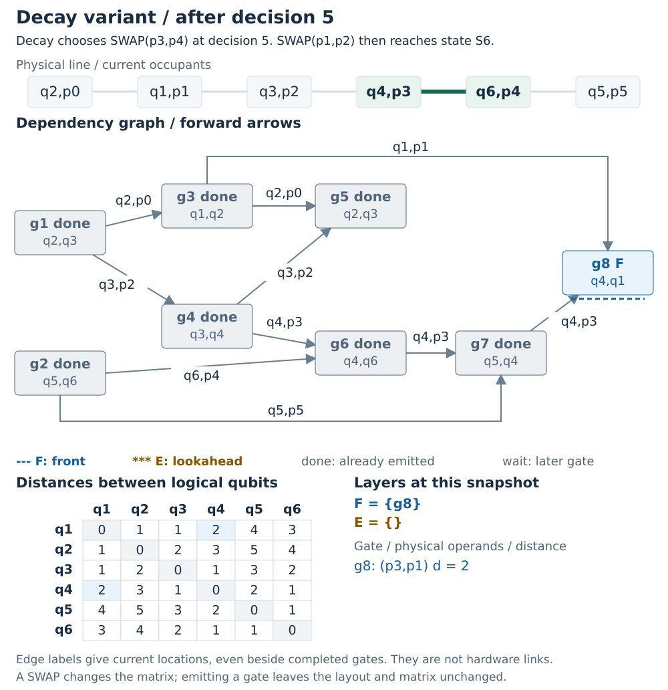

g8 is still at distance 2. Decision 6 then chooses `SWAP(p1, p2)` and emits
g8 at distance 1. The route uses the same snapshots S0 through S4, then the
snapshot above instead of S5, then S6. It has the same six SWAPs and final
layout as section 7; the last two SWAPs occur in the opposite selection order.
Those two SWAPs use disjoint wires, so changing their selection order alone
does not demonstrate a depth reduction in this example.

### 8.7 Exactly when the memory is cleared

A **search** here is a run of chosen SWAPs trying to make at least one front
gate executable. There can be several such searches in one routing trial.
The normal decay bookkeeping is:

1. **Score and choose** using the current multipliers.
2. **Apply the chosen SWAP**, then advance the search-step counter.
3. If that counter reaches 5, **reset all multipliers to 1** and the counter
   to 0. Do not increment either endpoint on this step. Otherwise, add
   `0.001` to each of the chosen SWAP's endpoint multipliers.
4. If no front gate became adjacent, score the next set of candidates with
   these updated multipliers.
5. If a gate became adjacent, emit it and all other gates enabled by the emit
   sweep. Then **reset all multipliers to 1** before the next search. This
   reset does **not** reset the search-step counter.

Thus there are two separate pieces of state: the per-wire multipliers and a
counter for the periodic reset. Emitting gates clears only the first. The
counter counts heuristic-selected search SWAPs across the whole routing trial;
it does not count emitted CX gates or the safety valve's forced SWAPs.

Here is the actual timeline for the decay route above. "All 1" means every
wire's multiplier is 1; the counter column is its value **after** the event.

| Event | Counter | Multipliers above 1 after the event | Why |
| --- | --- | --- | --- |
| Start | 0 | All 1 | Initial state. |
| Decision 1: SWAP(p2, p3) | 1 | p2, p3: 1.001 | Increment the chosen endpoints. |
| Emit g1 and g3 | 1 | All 1 | Emit sweep clears memory, not the counter. |
| Decision 2: SWAP(p3, p4) | 2 | p3, p4: 1.001 | Increment. |
| Emit g2, g4, g6 and g5 | 2 | All 1 | Emit sweep reset. |
| Decision 3: SWAP(p3, p4) | 3 | p3, p4: 1.001 | Increment. |
| Emit g7 | 3 | All 1 | Emit sweep reset. |
| Decision 4: SWAP(p0, p1) | 4 | p0, p1: 1.001 | No gate emitted; this survives into decision 5. |
| Decision 5: SWAP(p3, p4) | 0 | All 1 | Fifth search SWAP: periodic reset replaces increment. |
| Decision 6: SWAP(p1, p2) | 1 | p1, p2: 1.001 | Increment. |
| Emit g8 | 1 | All 1 | Emit sweep reset; routing ends. |

Notice the timing at decision 5: it is **scored with** p0 and p1 at 1.001,
then the winner is applied, and only **then** does the fifth-step reset occur.
Resetting before scoring would erase the very preference shown in section 8.5.
Decision 6, by contrast, sees all multipliers at 1 even though decision 5
emitted no gate. Its two distance-improving candidates are separated by ready
time: `(p1, p2)` has `T = 11`, while `(p2, p3)` has `T = 15` after the
SWAP on `(p3, p4)`. This checkout therefore picks `(p1, p2)`.

### 8.8 How strong is the preference, and what does it guarantee?

With increment `0.001` and a reset every fifth search SWAP, an endpoint can
accumulate at most four increments between periodic resets. Its multiplier
is therefore at most `1.004`; gate emissions often reset it sooner. This
configuration makes the reuse cost small: at most **0.4% of the positive
quantity being multiplied**.

For example, a post-SWAP distance score of 2 on a reused wire becomes 2.002;
it still beats a score of 3 on fresh wires. But decay is applied to **every**
candidate, not only to exact ties. A fresh candidate scoring 2.001 would beat
that 2.002 even though its distance score was slightly worse. Whether a
distance advantage survives depends on the actual totals and multipliers;
there is no general rule that distance always wins.

Decay encourages parallelism; it does not guarantee minimum depth, fewer
SWAPs, or an optimal route. It remembers recent search steps, not elapsed
hardware time. The name also does not mean the stored values gradually shrink:
in this implementation they increase on use and jump back to 1 on reset.
It has nothing to do with physical decoherence or qubit relaxation times.

To trace this in the code, start with `choose_best_swap` in
[`route.rs`](../crates/transpiler/src/passes/sabre/route.rs): it adds the
current total and multiplies by the maximum endpoint entry. Then read
`swap_map_trial` in the same file for the increment, fifth-step reset, and
post-emission reset. Section 13 combines this with all the other bookkeeping.

## 9. Ties, randomness, trials, and the safety valve

### Ties

Scores within `1e-10` of the best are treated as tied. The router keeps all
tied candidates and picks one with a seeded random generator. The same seed
always gives the same route.

### Multiple trials

`swap_map` runs the routing several times with different seeds (the `trials`
argument; the default is Qiskit's default process count, roughly the number of
physical CPU cores), possibly in parallel, and keeps the attempt with the
**fewest inserted SWAPs**. Only top-level SWAPs are counted; SWAPs inside
control-flow bodies (section 19) are ignored. Among equal counts, the earliest
trial wins. Depth is not measured when choosing:

| Trial | SWAPs inserted | Depth (measured afterwards, not used) | Chosen? |
| --- | --- | --- | --- |
| 0 | 5 | 12 | No |
| 1 | 4 | 15 | **Yes** |
| 2 | 4 | 11 | No, ties trial 1 and comes later |

So "best next SWAP" and "best complete route" use different criteria. The
per-step score guides construction; the swap count picks the winner.

### The safety valve

A lower score is a preference, not a guarantee that a gate becomes executable.
After every SWAP the router checks adjacency directly. It can happen that many
SWAPs in a row improve the score without ever making a front gate adjacent,
for example by chasing lookahead or fusion gains around in circles.

To prevent that, each search has an **attempt limit** (the Python wrappers use
`10 × number of qubits`). If more than that many SWAPs are chosen without
emitting any gate, the router:

1. **Rolls back** every SWAP chosen since the last emitted gate, restoring the
   layout, the layer bookkeeping, and this checkout's history arrays.
   Already-emitted gates stay.
2. Picks the front gate whose qubits are **closest**.
3. Finds a **shortest path** between its two positions.
4. Inserts SWAPs along that path, moving both ends toward the middle, until the
   pair is adjacent, and emits the gate.

**Example** on a five-position line with the front gate CX(q1, q5):

```text
Start:          [q1, q2, q3, q4, q5]     d(q1, q5) = 4
SWAP(p0, p1):   [q2, q1, q3, q4, q5]     d = 3
SWAP(p1, p2):   [q2, q3, q1, q4, q5]     d = 2
SWAP(p4, p3):   [q2, q3, q1, q5, q4]     d = 1  -> emit CX on (p2, p3)
```

The rollback is a compiler-side undo. Those SWAPs were never sent to hardware,
so no inverse SWAPs appear in the output.

## 10. The whole loop, with every step named

The same algorithm as section 3, now with the names used in `route.rs`:

```text
before routing (callers of swap_map):
    SabreDAG::from_dag: compress the circuit into routing nodes (section 18)
    RoutingTarget: compute the distance table from the coupling map

State::begin
    emit every initially executable gate; fill the front and lookahead layers
    advance_routed: ready times and fusion history for those initial gates

swap_map_trial:
    while the front layer is not empty:
        remember the output position                  (rollback point)
        until some front gate becomes adjacent:
            choose_best_swap                           (sections 6.1–6.3, 8, 11–13)
            apply it to the layout and layers          (section 6.4)
            advance_swap: ready times +3, clear block history (sections 11–12)
            update decay multipliers                   (section 8)
            if the attempt limit is exceeded:
                roll back; force_enable_closest_node   (section 9)
        update_route:
            record the chosen SWAPs and the gate(s) that became adjacent
            decrement successors; emit anything adjacent (section 6.5)
            rebuild the lookahead layer
            advance_routed: ready times and fusion history for emitted gates
        reset decay multipliers
    return the order of SWAPs and gates, plus the initial and final layouts
```

The router's long-lived state, for readers following the code:

| Field of `State` | Remembers |
| --- | --- |
| `layout` | Who is where right now. |
| `layers` | The front and lookahead layers, as physical partner pairs. |
| `predecessors` | The readiness counters, one copy per layer. |
| `decay` | The per-position multipliers of section 8. |
| `ready` | Estimated time each position becomes free (section 12). |
| `last_block` | The most recent fusible two-qubit block on each position (section 11). |
| `ready_undo` | Enough history to roll back `ready` and `last_block`. |
| `swap_scores`, `best_swaps` | Scratch space for candidates and the tied best. |
| `rng`, `seed` | The seeded random generator. |

---

# Part III — What this checkout adds to the score

Classic SABRE scores a candidate SWAP by distances alone. Two things it cannot
see:

- **A SWAP placed right after a CX on the same pair is cheaper than three CX.**
  A later optimization pass merges them, so the SWAP's real cost is lower.
- **A SWAP on busy wires has to wait**, while a SWAP on idle wires can run in
  parallel with other work. Distance says nothing about this.

This checkout adds a term for each. Both are small compared with a distance
step, both are computed from the history of the current routing attempt, and
both apply in every heuristic mode (`basic`, `lookahead`, `decay`). Part II's
walkthrough already used them at decisions 3 to 6; this part shows the
numbers.

## 11. Fusion credit: a SWAP right after a CX is cheaper

### The idea

A SWAP on positions a and b can be written as three CX gates:

```text
SWAP(a, b) = CX(a, b); CX(b, a); CX(a, b)
```

A CX undoes itself: applying the same CX twice in a row is the same as doing
nothing. So if the circuit already has `CX(a, b)` immediately before the SWAP on
the same two positions, the first two CX gates in the combined sequence cancel:

```text
Before:  CX(a, b); CX(a, b); CX(b, a); CX(a, b)       4 CX
After:                       CX(b, a); CX(a, b)       2 CX
```

A CX followed by a SWAP therefore needs only **2 CX gates in total** after
optimization. Here, "cost" counts two-qubit gates in CX units; any one-qubit
gates are excluded from this count.

Here are two longer examples. Read each sequence from left to right; `H(a)`
is a one-qubit gate on a. The vertical bar separates the existing block from
the appended SWAP. It is just a separator in this explanation, not a circuit
barrier.

**Example 1: a block with 2 CX gates, followed by a SWAP.**

```text
Existing block                | Appended SWAP
CX(b,a); H(a); CX(a,b)         | CX(a,b); CX(b,a); CX(a,b)
```

Counting the two parts separately gives `2 + 3 = 5` CX gates. But the last
`CX(a,b)` in the block and the first `CX(a,b)` in the SWAP are identical and
adjacent, so they cancel. The whole sequence becomes:

```text
CX(b,a); H(a); CX(b,a); CX(a,b)                 3 CX + 1 H
```

This shorter circuit has exactly the same effect on **every input state**
as the original block followed by the SWAP. The SWAP's effect is included in
the three remaining CX gates; there is no separate SWAP left to execute.

**Example 2: a block with 3 CX gates, followed by a SWAP.**

```text
Existing block                         | Appended SWAP
CX(a,b); H(a); CX(b,a); CX(a,b)          | CX(a,b); CX(b,a); CX(a,b)
```

The separate count is `3 + 3 = 6` CX gates. Cancel the two `CX(a,b)` gates
that meet at the separator:

```text
CX(a,b); H(a); CX(b,a); CX(b,a); CX(a,b)        4 CX + 1 H
```

Now the two `CX(b,a)` gates are adjacent and cancel too:

```text
CX(a,b); H(a); CX(a,b)                         2 CX + 1 H
```

Here the combined circuit uses **fewer** CX gates than the original block.
This is why the bound says *at most* 3: some blocks simplify further.

These examples use cancellations we can see directly. More generally,
re-synthesis means calculating the combined action of the block and SWAP,
then constructing a new circuit with that same action.

**Where the three-CX bound comes from.** The earlier cancellations illustrate
particular cases; they do not prove the general bound. That bound comes from
a decomposition theorem and a circuit construction:

1. **A long sequence on two qubits still has one 4-by-4 matrix.** A state of
   a and b has four amplitudes, corresponding to `00`, `01`, `10`, and `11`.
   Each gate transforms these amplitudes, and multiplying the gates' matrices
   gives the matrix `U` for the entire sequence. Whether the sequence contains
   5 gates or 500, `U` is still 4-by-4. A long list of instructions can describe
   a transformation that also has a much shorter implementation.

2. **The KAK (Cartan) decomposition gives every such matrix a standard form.**
   Ignoring an overall global phase, it says:

   ```text
   U = (A tensor B) V(alpha, beta, gamma) (C tensor D)
   V(alpha, beta, gamma) = exp[-i(alpha XX + beta YY + gamma ZZ)]
   ```

   Here A, B, C, and D are one-qubit gates: C and D run before V, and A and B
   run afterward. `XX` means `X tensor X`, a Pauli X on each qubit; `YY` and
   `ZZ` have the corresponding meanings. The middle operation V contains
   the interaction between the qubits, described by three real angles
   `alpha`, `beta`, and `gamma`. All the other work is in the one-qubit gates.

3. **There is a circuit for every V that uses exactly three CX gates.** The
   existence of three angles alone does not prove this count. The constructive
   part is a circuit whose one-qubit rotations can be adjusted to realize
   *any* values of those angles. Adding A, B, C, and D introduces no further
   CX gates. This is the proof strategy of
   [Vidal and Dawson, Theorem 1](https://arxiv.org/html/quant-ph/0307177).

For a concrete construction of step 3, the following sequence implements
V up to a fixed global phase. Run the rows from top to bottom:

| Step | Gates |
| --- | --- |
| 1 | `CX(a, b)` |
| 2 | `Rx(2 alpha - pi/2)` on a |
| 3 | H on a; `Rz(2 gamma)` on b |
| 4 | `CX(a, b)` |
| 5 | H on a; `Rz(-2 beta)` on b |
| 6 | `CX(a, b)` |
| 7 | `Rx(pi/2)` on a; `Rx(-pi/2)` on b |

`Rx(theta)` and `Rz(theta)` are one-qubit rotations, with the convention
`Rp(theta) = exp(-i theta P / 2)`. Multiplying the matrices in this table
gives `exp(i pi/4) V(alpha, beta, gamma)`. The leading factor is a global
phase, which can be tracked separately. The rotation angles change with V,
but the circuit always contains just **three CX gates**, at steps 1, 4, and 6.

Now apply this to routing. If a block has matrix U, appending a SWAP gives
`U_total = SWAP * U`, another 4-by-4 unitary matrix. Decompose U_total and use
the same three-CX construction with its new one-qubit gates and angles.
**We replace the entire sequence with a circuit for its final action.** The
construction works even if none of the original neighboring gates cancel.
It assumes arbitrary one-qubit rotations are available; those rotations
are essential and are excluded from the CX count.

The restriction to one pair matters. `H(a)` in these examples stays within
the pair a, b. A gate such as `CX(b,d)` would involve a third qubit d, so the
whole sequence would no longer be a two-qubit block and this bound would not
apply to it. Measurements also fall outside this unitary re-synthesis rule.

Suppose the router is considering `SWAP(a, b)`. Look at the gates it has
already placed most recently on those two physical wires. If they form an
eligible run of gates confined to a and b, that run is the **existing block**
that might be combined with the proposed SWAP.

The router keeps a small number `c` for this run: its rough estimate of how
many CX gates would implement the run **before adding the SWAP**. For a run
containing only CX gates and one-qubit gates, it counts the CX gates and
stores at most 3:

| CX gates in the existing run | Stored estimate `c` |
| --- | --- |
| 1 | 1 |
| 2 | 2 |
| 3 | 3 |
| 4 | 3 |
| 10 | 3 |

This is what **"capped at 3"** means: `c = min(3, count)`. The three-CX
synthesis bound motivates the cap. The router still retains the original
gates; storing `c = 3` does not itself rewrite them. Nor does it prove that
the minimum is exactly 3: the router does not search for cancellations when
computing this estimate. Other gate types receive the contributions listed
below under "How the router keeps track".

For an eligible block, `c` is therefore 1, 2, or 3. The router combines two
observations:

- **If `c = 1`:** the CX-and-SWAP cancellation above motivates an estimate of
  2 CX gates for the combined block.
- **If `c = 2` or `c = 3`:** the general two-qubit synthesis result gives an
  upper bound of 3 CX gates for the combined block.

These cases fit into one formula:

```text
Estimated total cost after fusion = min(3, c + 1)
```

The `c + 1` gives 2 when `c = 1`; the cap at 3 handles the other two cases.
For example, when `c = 3`, keeping the block and SWAP separate would cost
`3 + 3 = 6` CX gates, while rewriting them together needs at most 3. In this
estimate, the SWAP adds no two-qubit gates to that block's cost.

This is a routing estimate, not a guarantee of the final gate count. Qiskit's
optimization passes can perform the re-synthesis after routing; the router
only predicts the saving and uses it to help choose a SWAP.

### How the router keeps track

A **routing node** is a record in the router's dependency graph. It represents
one or more original circuit operations that the router handles together.
For example, once q0 and q1 are on adjacent physical positions, this whole
sequence can run without another routing decision:

```text
CX(q0, q1); H(q0); CX(q1, q0); Rz(0.2) on q1
```

The router groups these four operations into one two-qubit routing node R1
for the pair (q0, q1). If the next operation is `CX(q1, q2)`, that needs a
different pair to be adjacent and becomes another node R2:

```text
R1: four operations on q0, q1  --->  R2: CX(q1, q2)
```

The arrow means R2 must wait for R1. Grouping the operations does not turn
them into a single hardware gate: when R1 is emitted, its original four
operations are emitted in order. Section 18 explains this compression in
more detail.

**`block` is the name of a numeric field in that record.** `R1.block` stores
R1's estimated contribution to the CX cost. The operations themselves are
recorded separately. The router assigns contributions as follows:

| Operation in the node | Contribution to `node.block` |
| --- | --- |
| CX, CY, CZ, ECR | 1 |
| Any other two-qubit gate | 3 (worst case) |
| One-qubit gate folded into the node | 0 |
| Measurement, reset, barrier, delay, control flow, and other non-gate instructions | none: these end a block |

For a node containing several gates, add their contributions and cap the
sum at 3. If any operation ends a block, the node's field is `None` instead.
In the example above:

```text
R1.block = min(3, 1 + 0 + 1 + 0) = 2
                 CX  H   CX  Rz
R2.block = 1
```

There are **two different quantities** to keep separate:

| Quantity | What it describes | When it is computed |
| --- | --- | --- |
| `node.block` | The contribution of the original operations grouped into one routing node. | When the circuit is compressed, before routing. |
| `c` | The accumulated estimate for the current run of emitted gates on one physical pair. | During routing, as nodes are emitted. |

For example, suppose R1 is emitted with q0 at p2 and q1 at p3, and there is
no earlier block to continue on that pair. Its `block` value of 2 starts a
new accumulated estimate `c = 2` on p2, p3. A proposed `SWAP(p2, p3)` would
then be scored using `c = 2`: separate cost `2 + 3 = 5`, estimated combined
cost `min(3, 2 + 1) = 3`.

If an emitted node continues an existing eligible block on the same physical
pair, its contribution is added: `c = min(3, old c + node.block)`. If it starts
a fresh block, `c` starts at `node.block`.

During routing, every physical position remembers its **most recent block**:
`last_block[p] = (partner, c)`, meaning "the last two-qubit work on p was with
`partner`, and the block costs about `c` gates (at most 3)". The rules:

| Event | Effect on `last_block` |
| --- | --- |
| A two-qubit node is emitted on (a, b) | If a and b already named each other, the block continues: `c = min(3, old c + node's block)`. Otherwise a fresh block starts with the node's value. Both a and b now name each other. If the node's `block` is none (it absorbed a block-ending operation), both records are cleared instead. |
| A SWAP is chosen on (a, b) | Both records are cleared. |
| Any node that is not a two-qubit routing node runs on p (measurement, reset, barrier, delay, control flow, an operation on three or more qubits) | p's record is cleared (final routing only; see section 17). |

Gates that are emitted at the very start, before any SWAP, follow the same
rules: the routine that applies them (`advance_routed`) runs for the initially
executable gates too, and likewise for the ready times of section 12. Section
16 relies on this.

### The credit

A candidate SWAP on (a, b) gets a credit only if `last_block[a]` names b
**and** `last_block[b]` names a. Then, with `c` the block's cost:

```text
without fusion:  c + 3          (the block, then a full SWAP)
with fusion:     min(3, c + 1)  (estimated total for the block and SWAP)
saving         = (c + 3) − min(3, c + 1)
credit         = −saving / 3    (in units of "one SWAP", the same units as distance)
```

| Previous block cost c | Separate cost | Estimated fused cost | Saving | Credit |
| --- | --- | --- | --- | --- |
| no eligible block | — | — | 0 | 0 |
| 1 (one CX) | 4 | 2 | 2 | −2/3 |
| 2 | 5 | 3 | 2 | −2/3 |
| 3 | 6 | 3 | 3 | −1 |

A credit of −2/3 is worth two thirds of a distance step. That is deliberately
large: it is the estimated saving in real gates.

### The walkthrough, with fusion credit

Follow `last_block` through Part II's route:

| Event | last_block afterward (position: partner, cost) |
| --- | --- |
| SWAP(p2, p3) | p2 and p3 cleared (they were empty anyway) |
| g1 = CX on (p1, p2) | p1: (p2, 1), p2: (p1, 1) |
| g3 = CX on (p0, p1) | p0: (p1, 1), p1: (p0, 1); p2 still names p1 |
| SWAP(p3, p4) | p3 and p4 cleared |
| g2 = CX on (p5, p4) | p4: (p5, 1), p5: (p4, 1) |
| g4 = CX on (p2, p3), with the two H gates | p2: (p3, 1), p3: (p2, 1); the folded H gates add 0 |
| g6 = CX on (p3, p4), with the Z gate | p3 named p2 and p4 named p5, so this is a fresh block: p3: (p4, 1), p4: (p3, 1) |
| g5 = CX on (p1, p2) | p1: (p2, 1), p2: (p1, 1) |

**Decisions 1 and 2.** No two-qubit gate had yet been emitted on any
candidate pair, so no credit applied.

**Decision 3.** Candidates (p2, p3), (p3, p4), (p4, p5):

| Candidate | ΔD_F | w × ΔD_E | Both endpoints name each other? | Credit | Sum |
| --- | --- | --- | --- | --- | --- |
| SWAP(p2, p3) | +1 | −0.0833 | No: p2 names p1, p3 names p4 | 0 | +0.9167 |
| SWAP(p3, p4) | −1 | +0.0833 | Yes, from g6 | −2/3 | **−1.5833** |
| SWAP(p4, p5) | −1 | 0 | No: p4 names p3 | 0 | −1.0000 |

The credit chooses SWAP(p3, p4): after optimization, `CX(p3, p4); SWAP(p3, p4)`
becomes two CX gates instead of four. Note that this is not a tie-break.
Without the credit SWAP(p4, p5) wins by one twelfth; a credit worth two thirds
of a distance step overturns that. The credit can beat the lookahead term,
whose weight is at most `w` per gate, but it cannot beat a full distance step
in the wrong direction: a SWAP that moves a front pair *apart* (ΔD_F = +1)
still scores +1/3 with the credit, as decisions 4 to 6 show.

After SWAP(p3, p4) is chosen, p3 and p4 are cleared. g7 = CX on (p5, p4) then
makes p4 and p5 name each other, so SWAP(p4, p5) carries a credit of −2/3 at
decisions 4, 5 and 6. It never wins, because it moves q4 away from q1: its
score is +1 − 2/3 = +1/3 each time, against −1 for the candidates that close
the distance.

### What the estimate does not check

The classifier is coarse on purpose, so that it costs almost nothing per
candidate. It does not verify that the later optimization pass will really
accept the block (parameters, opaque instructions, and optimization level all
matter), so a credited saving can fail to materialize. That affects route
quality only, never correctness: the router still emits a complete SWAP, and
whether it gets merged later is up to other passes.

## 12. Ready time: prefer wires that are free sooner

### The idea

Think of each physical position as having a clock: "the two-qubit work already
assigned to this wire ends at time T". A gate on two wires can start only when
both are free. If two candidate SWAPs are otherwise equal, the one whose wires
free up earlier can start earlier and is less likely to lengthen the circuit.

### The bookkeeping

`ready[p]` starts at 0 for every position and is updated like this:

```text
When a SWAP is chosen on (a, b):          end = max(ready[a], ready[b]) + 3
                                          ready[a] = ready[b] = end

When a two-qubit node is emitted on (a, b): end = max(ready[a], ready[b]) + 1
                                          ready[a] = ready[b] = end
```

A SWAP counts as 3 layers (three native gates); a routed two-qubit node counts
as 1, even if it contains several gates. Ready times belong to **positions**,
not to program qubits, so they are not exchanged by a SWAP.

Through Part II's route:

| Event | p0 | p1 | p2 | p3 | p4 | p5 |
| --- | --- | --- | --- | --- | --- | --- |
| Start | 0 | 0 | 0 | 0 | 0 | 0 |
| SWAP(p2, p3) | 0 | 0 | 3 | 3 | 0 | 0 |
| g1 on (p1, p2) | 0 | 4 | 4 | 3 | 0 | 0 |
| g3 on (p0, p1) | 5 | 5 | 4 | 3 | 0 | 0 |
| SWAP(p3, p4) | 5 | 5 | 4 | 6 | 6 | 0 |
| g2 on (p5, p4) | 5 | 5 | 4 | 6 | 7 | 7 |
| g4 on (p2, p3) | 5 | 5 | 7 | 7 | 7 | 7 |
| g6 on (p3, p4) | 5 | 5 | 7 | 8 | 8 | 7 |
| g5 on (p1, p2) | 5 | 8 | 8 | 8 | 8 | 7 |
| SWAP(p3, p4) | 5 | 8 | 8 | 11 | 11 | 7 |
| g7 on (p5, p4) | 5 | 8 | 8 | 11 | 12 | 12 |
| SWAP(p0, p1) | 11 | 11 | 8 | 11 | 12 | 12 |
| SWAP(p1, p2) | 11 | 14 | 14 | 11 | 12 | 12 |
| SWAP(p3, p4) | 11 | 14 | 14 | 15 | 15 | 12 |
| g8 on (p3, p2) | 11 | 14 | 16 | 16 | 15 | 12 |

Read the g2 and g4 rows: g2 on (p5, p4) starts at `max(0, 6) = 6`, right
after the SWAP on p4, and ends at 7; g4 on (p2, p3) also starts at
`max(4, 6) = 6` and ends at 7. The estimate lets them overlap, because they
use different wires. The one-qubit gates folded into g4 and g6 add nothing: a
routed node counts as one layer whatever it contains.

### The penalty

Each candidate SWAP on (a, b) pays

```text
ready penalty = 0.000022 × max(ready[a], ready[b])
```

The coefficient is tiny, so this term only matters when everything else is
nearly equal, but it is added to every candidate, not applied only after exact
ties. A large enough difference in ready time can outweigh a small lookahead
difference.

**Decision 3 in full** (lookahead mode, so no decay):

| Candidate | ΔD_F | w × ΔD_E | Credit | Ready of endpoints | Penalty | Total |
| --- | --- | --- | --- | --- | --- | --- |
| SWAP(p2, p3) | +1 | −0.0833 | 0 | 8, 8 | 0.000176 | +0.916843 |
| SWAP(p3, p4) | −1 | +0.0833 | −2/3 | 8, 8 | 0.000176 | **−1.583157** |
| SWAP(p4, p5) | −1 | 0 | 0 | 8, 7 | 0.000176 | −0.999824 |

Here the credit already decided; the ready penalties are equal and change
nothing.

### Decisions 4 to 6: the ready term decides by itself

After g7, only g8 = CX(q4, q1) is left, at distance 4, and the lookahead
layer is empty. At each of the next three decisions two candidates close the
distance by one step and nothing but the ready term separates them. The ready
times are those of the table above.

**Decision 4** (`ready = [5, 8, 8, 11, 12, 12]`):

| Candidate | ΔD_F | Credit | Ready of endpoints | Penalty | Total |
| --- | --- | --- | --- | --- | --- |
| SWAP(p0, p1) | −1 | 0 | 5, 8 | 0.000176 | **−0.999824** |
| SWAP(p3, p4) | −1 | 0 | 11, 12 | 0.000264 | −0.999736 |
| SWAP(p4, p5) | +1 | −2/3 | 12, 12 | 0.000264 | +0.333597 |

**Decision 5** (`ready = [11, 11, 8, 11, 12, 12]`):

| Candidate | ΔD_F | Credit | Ready of endpoints | Penalty | Total |
| --- | --- | --- | --- | --- | --- |
| SWAP(p1, p2) | −1 | 0 | 11, 8 | 0.000242 | **−0.999758** |
| SWAP(p3, p4) | −1 | 0 | 11, 12 | 0.000264 | −0.999736 |
| SWAP(p0, p1) | +1 | 0 | 11, 11 | 0.000242 | +1.000242 |
| SWAP(p4, p5) | +1 | −2/3 | 12, 12 | 0.000264 | +0.333597 |

**Decision 6** (`ready = [11, 14, 14, 11, 12, 12]`):

| Candidate | ΔD_F | Credit | Ready of endpoints | Penalty | Total |
| --- | --- | --- | --- | --- | --- |
| SWAP(p3, p4) | −1 | 0 | 11, 12 | 0.000264 | **−0.999736** |
| SWAP(p2, p3) | −1 | 0 | 14, 11 | 0.000308 | −0.999692 |
| SWAP(p1, p2) | +1 | 0 | 14, 14 | 0.000308 | +1.000308 |
| SWAP(p4, p5) | +1 | −2/3 | 12, 12 | 0.000264 | +0.333597 |

The margins are a few hundred-thousandths, but they are systematic: the
candidate whose wires have been idle longest wins. Classic SABRE would flip
three coins here. The result is that q1 walks two steps along the wires p0,
p1, p2, which have been free since g3 and g5, while the busy wires p3 to p5
are still finishing g7, and only the last step uses p3 and p4. Running this in
Qiskit (section 21), every seed gives the same output circuit.

### What the number means

`ready[p]` is an estimated layer index counted from the start of the circuit.
It is not seconds, not an error rate, and not a measured idle time. It is a
cheap proxy that steers the router toward parallel-friendly choices.

## 13. The complete score, in the order the code computes it

| Symbol | Meaning |
| --- | --- |
| `ΔD_F` | Change in the summed front-layer distances (section 6.2). |
| `ΔD_E` | Change in the summed lookahead-layer distances (section 6.3). |
| `b` | Basic weight: 1, or `1 / (number of front gates)` in `basic` mode. |
| `w` | Lookahead weight: `0.5 / (number of physical qubits)`. |
| `f` | Fusion credit: 0, −2/3, or −1 (section 11). |
| `H_now` | Current weighted distance total, `b × D_F + w × D_E` (section 8). |
| `m` | Larger decay multiplier of the two endpoints (section 8). |
| `T` | Larger ready time of the two endpoints (section 12). |

`choose_best_swap` computes, for every candidate:

```text
x = b × (f + ΔD_F)               fusion credit and front distance, scaled together
x = x + w × ΔD_E                 lookahead
if decay is enabled:
    x = (H_now + x) × m          make it absolute, then penalize reused wires
score = x + 0.000022 × T         ready-time penalty, added last and never multiplied
```

The candidate with the smallest score wins; ties within `1e-10` are broken at
random.

Two details that are easy to miss: the basic weight scales the fusion credit as
well as the distance change, and the ready penalty is added *after* decay, so
the decay multiplier never touches it.

### The bookkeeping, in event order

To route a new circuit by hand with this checkout's exact choices, update the
state in this order:

1. **Choose** the candidate with the smallest score (formula above).
2. **Apply the SWAP** on (a, b): swap the occupants of a and b in the layout.
3. **Ready times:** `ready[a] = ready[b] = max(ready[a], ready[b]) + 3`.
4. **Fusion history:** clear `last_block[a]` and `last_block[b]`.
5. **Decay** (decay mode only): add 0.001 to a's and b's multipliers, or reset
   all multipliers if this is the fifth search SWAP.
6. **Check adjacency** of the front gates on a and b. If none is adjacent, go
   back to step 1 (the safety valve of section 9 bounds this).
7. **Emit** each newly adjacent gate on its positions (x, y), then any
   successor that becomes ready and is adjacent, and so on. For each emitted
   two-qubit node: `ready[x] = ready[y] = max(ready[x], ready[y]) + 1`, and
   update `last_block[x]`, `last_block[y]` by the rules of section 11.
   Blocked successors join the front layer.
8. **Rebuild the lookahead layer** from the new front; reset all decay
   multipliers to 1; go back to step 1 if the front is not empty.

The three named modes of the Python wrappers:

| Mode | `b` | Lookahead | Decay | Fusion and ready terms |
| --- | --- | --- | --- | --- |
| `basic` | `1 / number of front gates` | none | none | included |
| `lookahead` | 1 | one layer, `w = 0.5 / qubits` | none | included |
| `decay` | 1 | same as lookahead | +0.001 per use; every fifth search SWAP resets all to 1 | included |

`SabreSwap` defaults to `basic`; `SabreLayout`'s integrated path uses the
`decay` configuration. In `basic` mode the two-gate improvement of −2 from
section 6.2 would be reported as −1, because it is averaged over the two front
gates.

## 14. What these estimates do not know

Collected here so that the main text can stay simple:

- A compressed routing node (section 18) adds **1** to ready time even if it
  holds several two-qubit gates, while its fusion estimate may be 3. The two
  fields are different approximations.
- Barriers and measurements clear fusion history but do **not** synchronize
  ready times. After a global barrier, `[10, 10, 0, 0]` stays as it is, even
  though later work on p2 and p3 really has to wait.
- A chosen SWAP adds 3 to ready time even when the fusion credit predicted it
  would merge into a cheaper block.
- Nested control-flow blocks are routed with their own fresh state; the outer
  ready times do not include their duration.
- Complete routing attempts are still compared by **top-level SWAP count**
  (section 9), not by native gate count or depth. The new terms change how each
  attempt is built, not how the winner is picked.
- Both terms are history, so the safety valve (section 9) rolls them back
  together with the layout when it undoes a failed search.

---

# Part IV — Choosing the initial layout

## 15. The idea: route it backward

Part II started with everyone in a fixed arrangement and paid two SWAPs before
the first two gates could run, then three more at the end to bring q4 and q1
together. If q6 had started next to q5, and q1 nearer to q4, several of those
SWAPs would have been unnecessary. `SabreLayout` searches for a starting
arrangement that suits the *whole* circuit, not just its first gates, and it
does so by reusing the router.

The trick has two observations:

1. **The end of a forward route is a good arrangement for the end of the
   circuit.** Routing moves qubits toward the pairs that interact; by the last
   gate, the layout has adapted to the circuit's late interactions.
2. **Routing the dependencies in reverse carries that arrangement back to the
   start.** Reverse every "must come before" arrow, so the last gates come
   first, and route again starting from the forward route's final layout. The
   final layout of *that* route is adapted to the circuit's first gates, while
   still remembering what the end needed.

```text
starting guess L0
    ── route forward ──▶ final layout L1      (good for the end of the circuit)
    ── route backward ─▶ final layout L2      (good for the start, informed by the end)

use L2 as the initial layout, or as the next starting guess
```

"Backward" means the **dependency graph is reversed**: g5 and g8 are visited
first and g1 and g2 last. The compiler is not running the circuit in reverse time, inverting
gates, or undoing measurements. Only the pattern of *which pairs interact in
which order* matters for choosing a layout, and that pattern can be walked in
either direction.

## 16. Worked example: six SWAPs become four

`SabreLayout` runs every pass with the decay configuration (section 13), so
the numbers below include the decay multiplier; everything else is the scoring
of Parts II and III. Each pass starts with fresh ready times, fusion history
and decay multipliers; only the layout carries over.

**Forward pass.** Route the circuit from `[q1, q2, q6, q3, q4, q5]`. This is
Part II's route again with one change: decay reverses the order of the last
two SWAPs (section 8 works out that decision). The pass ends at
`[q2, q3, q1, q4, q6, q5]`. Keep only that final layout.

### Backward pass: states B0 to B5

Reverse every dependency, so the obligations now run g5
and g8 first, then g3 and g7, and so on back to g1 and g2. Start from
`[q2, q3, q1, q4, q6, q5]`:

**Start, B0.** The layout carries over, but the completed-gate set starts
empty for this new pass. g5 on (p0,p1) and g8 on (p3,p2) are adjacent and
can be visited immediately. This makes g3 and g7 ready, both at distance 2.
`F = {g3,g7}`, `E = {g6}`; g4 still waits for g6.

The graph uses the **same node positions as the forward walkthrough, with
every arrow reversed**. Grey now means visited in this backward pass. These
visits explore a layout; they do not append gates to the final output circuit.
The distance matrix uses the same fixed logical-qubit order as before.

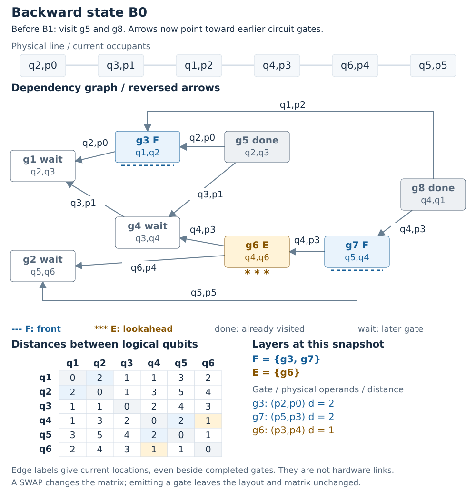

**Decision B1.** SWAP(p0,p1) brings q2 next to q1 and carries a fusion
credit from g5 on (p0,p1). Visit g3 on (p2,p1). g1 still waits for g4.

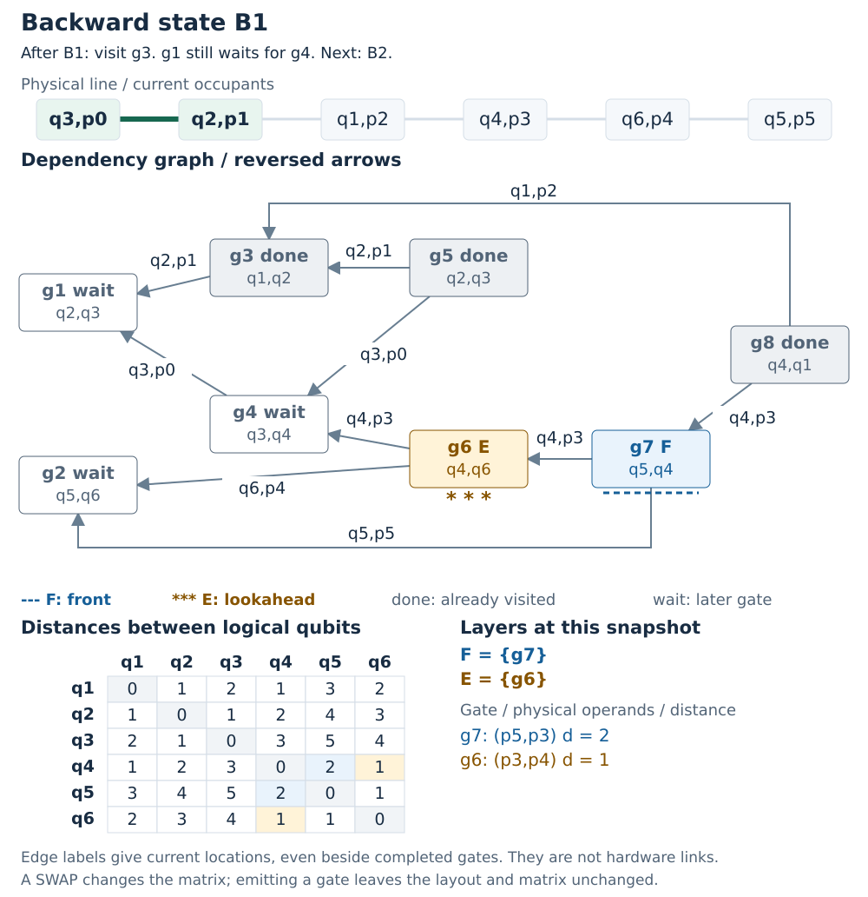

**Decision B2.** SWAP(p3,p4) makes g7 adjacent. Lookahead prefers it to
SWAP(p4,p5), which would move q6 away from q4. Visit g7 on (p5,p4), then
g6 on (p4,p3). g4 and g2 become the front, at distances 4 and 2.

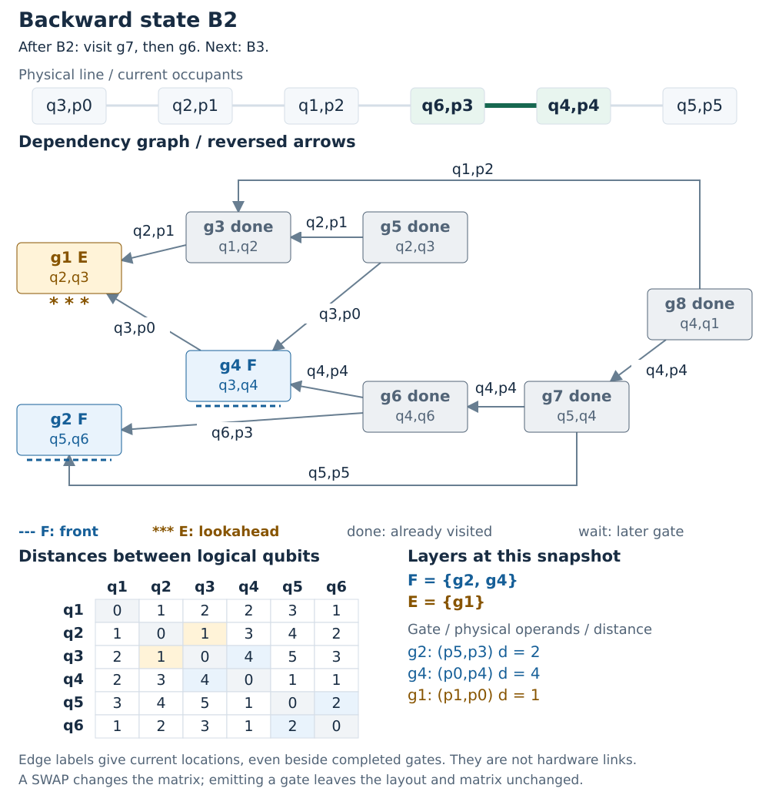

**Decision B3.** SWAP(p3,p4) has `ΔD_F = -2`, helping g4 and g2 at once,
plus a fusion credit from g6. Visit g2 on (p5,p4). g4 remains at distance 3.

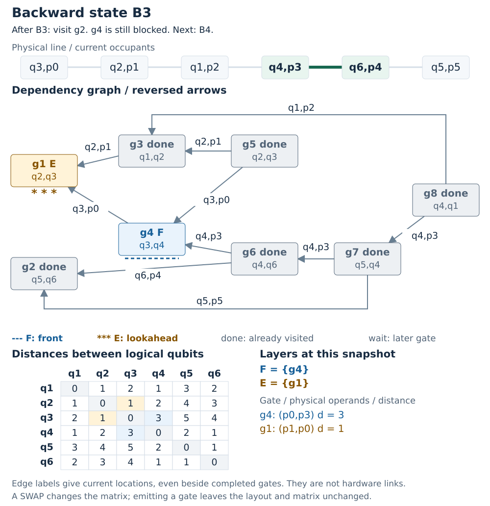

**Decision B4.** SWAP(p0,p1) ties SWAP(p2,p3) on distance. The ready term
prefers p0 and p1 (free at 5, versus 9 for p3). g4 is still blocked, now at
distance 2; no gate is visited.

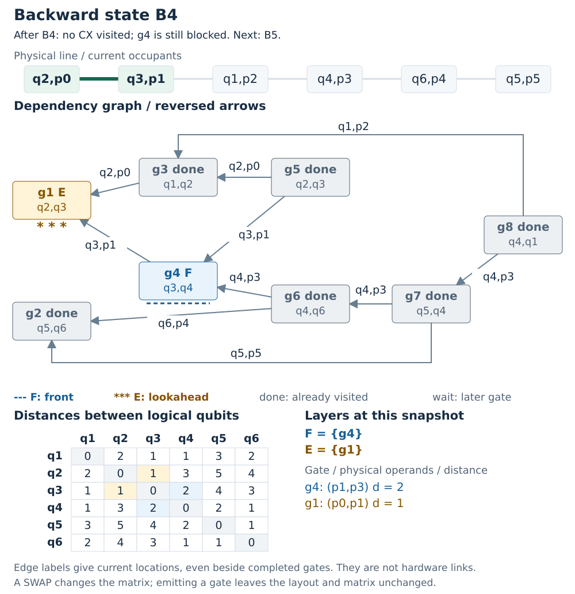

**Decision B5.** SWAP(p2,p3) makes g4 adjacent. Visit g4 on (p1,p2), then
g1 on (p0,p1). The backward pass is complete.

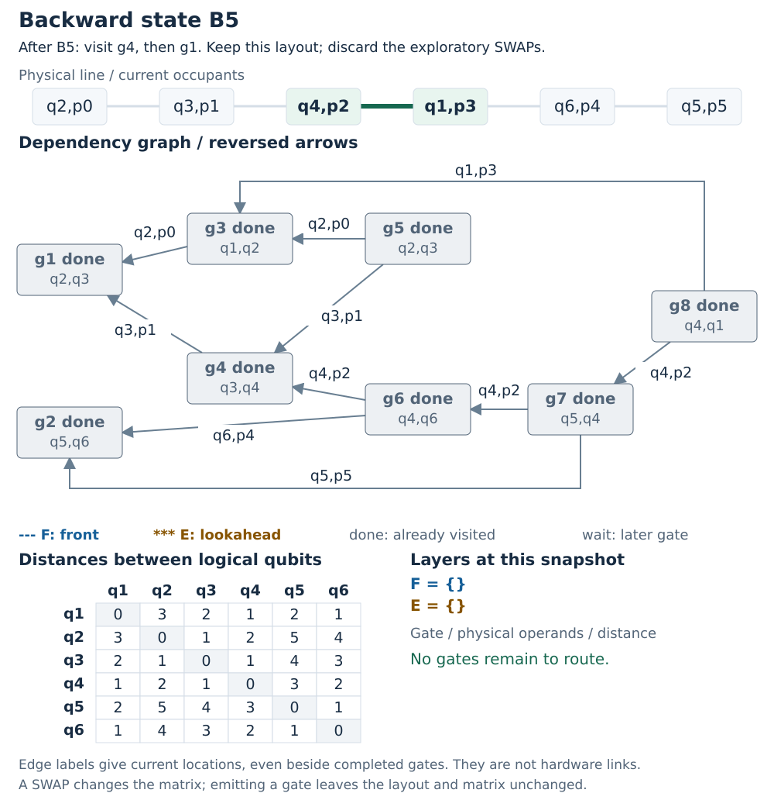

The scores behind those choices, showing the winner and its closest rival at
each decision (`H_now` is the weighted distance total that decay mode adds
back, section 8):

| Decision | Candidate | H_now + ΔD_F + w × ΔD_E | Credit | × m | Ready penalty | Total |
| --- | --- | --- | --- | --- | --- | --- |
| B1 | SWAP(p0, p1) | 4.0833 − 1 + 0 | −2/3 | 2.4167 | 0.000022 | **2.416689** |
| B1 | SWAP(p3, p4) | 4.0833 − 1 + 0 | 0 | 3.0833 | 0.000022 | 3.083355 |
| B2 | SWAP(p3, p4) | 2.0833 − 1 + 0 | 0 | 1.0833 | 0.000022 | **1.083355** |
| B2 | SWAP(p4, p5) | 2.0833 − 1 + 0.0833 | 0 | 1.1667 | 0 | 1.166667 |
| B3 | SWAP(p3, p4) | 6.0833 − 2 + 0 | −2/3 | 3.4167 | 0.000132 | **3.416799** |
| B3 | SWAP(p0, p1) | 6.0833 − 1 + 0 | 0 | 5.0833 | 0.000110 | 5.083443 |
| B4 | SWAP(p0, p1) | 3.0833 − 1 + 0 | 0 | 2.0833 | 0.000110 | **2.083443** |
| B4 | SWAP(p2, p3) | 3.0833 − 1 + 0 | 0 | 2.0833 | 0.000198 | 2.083531 |
| B5 | SWAP(p2, p3) | 2.0833 − 1 + 0 | 0 | 1.0833 | 0.000198 | **1.083531** |
| B5 | SWAP(p1, p2) | 2.0833 − 1 + 0.0833 | 0 | 1.1667 × 1.001 = 1.1678 | 0.000176 | 1.168009 |

(At B1, SWAP(p1, p2) scores the same as SWAP(p3, p4). At B5 the multiplier
1.001 applies because SWAP(p0, p1) was chosen at B4 in the same search.)

The backward pass ends at `[q2, q3, q4, q1, q6, q5]`. Its five SWAPs are
discarded, like the six of the forward pass; only this layout survives.

### Refined forward pass: states R0 to R4

**Use B5's layout as the initial layout** and route the real circuit forward, still
with the decay configuration, since `SabreLayout` does the final routing too:

**Start, R0.** Reset progress for a new forward pass. One-qubit gates run as
soon as their dependencies allow. g1 on (p0,p1), g2 on (p5,p4), and g4 on
(p1,p2) are adjacent and are emitted before any SWAP. `F = {g3,g6}`:
their distances are 3 and 2. `E = {g5,g7}`.

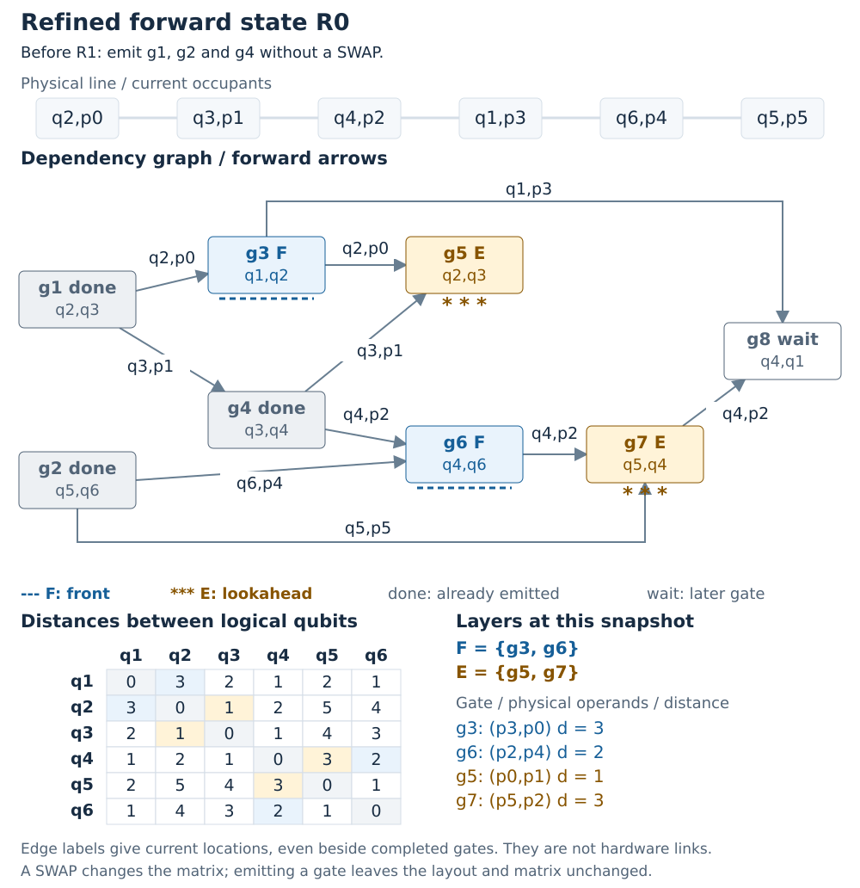

**Decision R1.** SWAP(p2,p3) has `ΔD_F = -2`, helping g3 and g6, and
also brings g7's pair closer. Emit g6 on (p3,p4), with its Z. g7 joins
g3 in the front. Both g5 and g8 are in lookahead: pretending the entire
front is done satisfies their remaining dependencies.

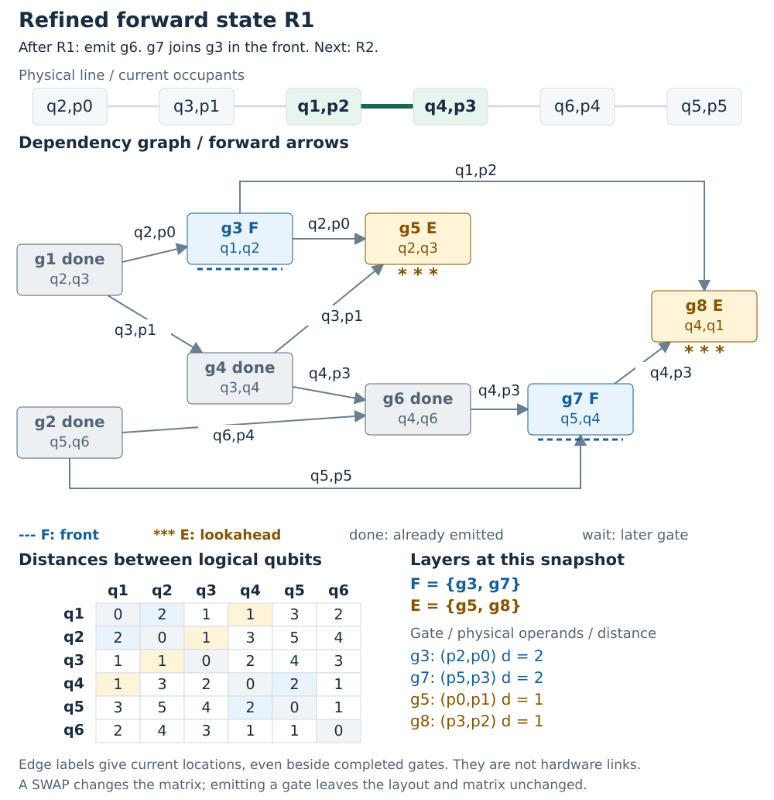

**Decision R2.** SWAP(p3,p4) makes g7 adjacent, with a fusion credit from
g6. Emit g7 on (p5,p4). g8 must still wait for g3, so it stays in E.

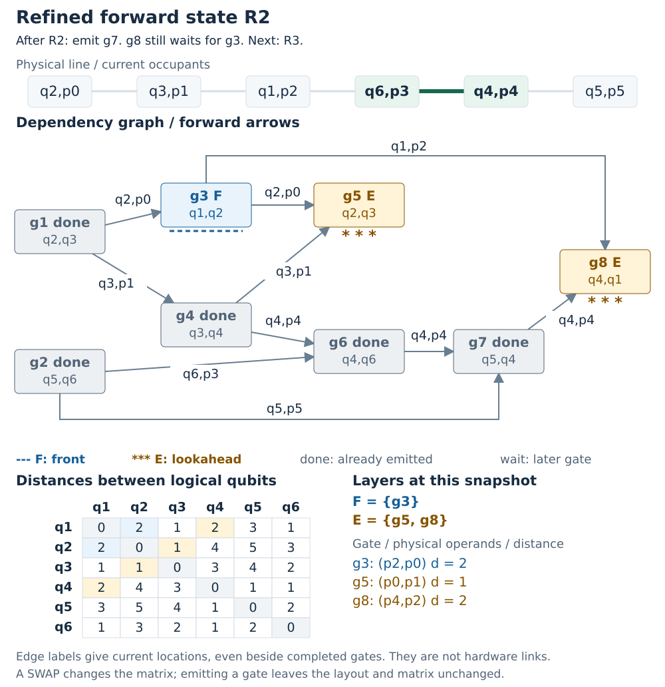

**Decision R3.** SWAP(p0,p1) makes g3 adjacent without disturbing g5 or
g8, which SWAP(p1,p2) would have pulled apart. Emit g3 on (p2,p1), then
g5 on (p1,p0). g8 becomes the front, at distance 2.

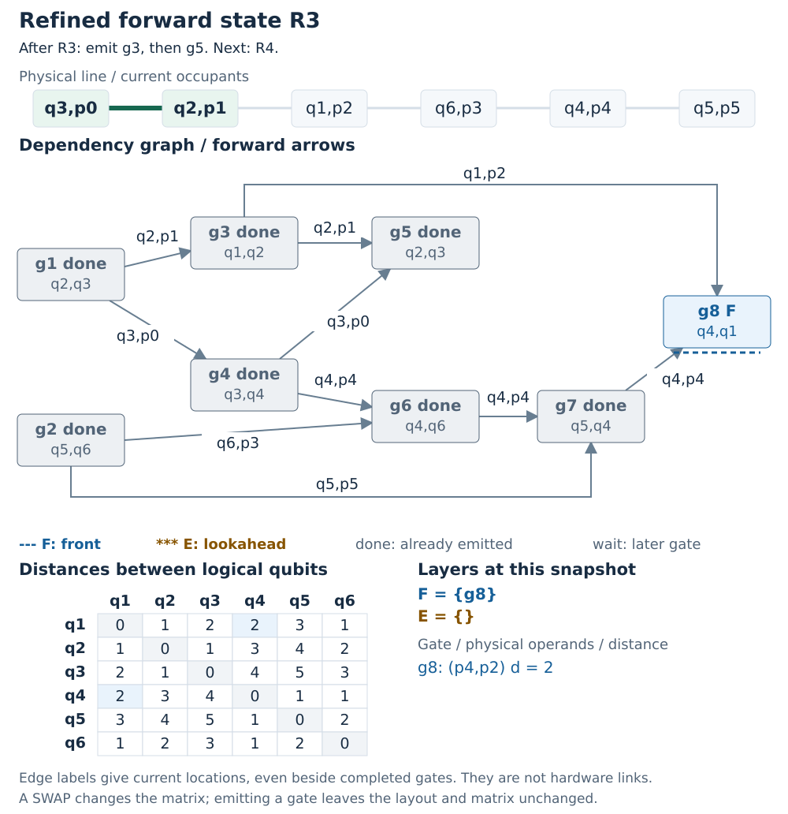

**Decision R4.** SWAP(p2,p3) ties SWAP(p3,p4) on distance. The ready term
prefers p2 and p3 (free at 9, versus 10). Emit g8 on (p4,p3). Finished.

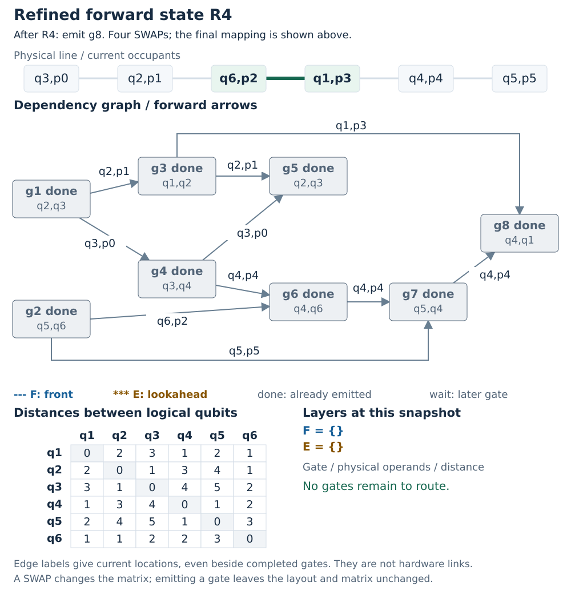

The output circuit:

```text
              g1  g2  g4          g6          g7      g3  g5      g8
p0  ───H───────●───────────────────────────────────X───────⊕──────────
               │                                   │       │
p1  ───────────⊕───────●───H───────────────────────X───⊕───●──────────
                       │                               │
p2  ───────────────────⊕───H───X───────────────────────●───────X──────
                               │                               │
p3  ───H───Z───────────────────X───●───Z───X───────────────────X───⊕──
                                   │       │                       │
p4  ───────────────⊕───────────────⊕───────X───⊕───────────────────●──
                   │                           │
p5  ───H───────────●───────────────────────────●──────────────────────
```

**Four SWAPs instead of six.** The eleven exploratory SWAPs used during the
search (six forward, five backward) were never added to any output. Only the
layout they produced survives. Note also how the final route emits three CX
gates before its first SWAP: the layout was shaped by the backward pass to suit
the start of the circuit.

Larger circuits benefit from repeating the forward/backward pair several
times. Each repetition is a heuristic pass, so improvement is likely but not
guaranteed.

## 17. What one layout trial runs

`layout_trial` in `layout.rs` performs these steps for one starting guess:

1. **Complete the starting layout.** Fill in any unspecified program qubits at
   random, and invent placeholder program qubits ("ancillas") for every
   physical position the circuit does not use, so that the layout is a full
   permutation of all positions. A supplied partial layout only
   seeds the search; its assignments may move during the exploratory passes.
2. **Route forward once.** Keep the final layout; throw away the SWAPs.
3. **Route backward once**, starting from that layout. Keep its final layout.
4. **Repeat steps 2–3 `max_iterations` times.** The default of 3 means three
   forward and three backward passes. Each pass starts with fresh decay,
   ready-time and fusion history; only the layout is carried over.
5. **Route the real circuit** from the resulting layout, `swap_trials` times
   with different seeds, and keep the attempt with the fewest SWAPs.

The pass runs many such trials from different starting guesses and keeps the
one whose final routing used the fewest SWAPs:

| Starting guesses tried | Count |
| --- | --- |
| Fully random layouts | `layout_trials` (default: Qiskit's default process count) |
| User-supplied partial layouts | as many as given |
| A densely connected subset of the device (`dense_layout`) | 1 |
| Program qubit *i* at position *i* | 1 |
| Program qubit *i* at position *n − 1 − i* | 1 |
| A device-specific ring, for 127-, 133- and 156-qubit IBM devices | 1 if applicable |

Three parameters, often confused:

| Parameter | Controls |
| --- | --- |
| `max_iterations` | Forward/backward pairs per starting guess. |
| `layout_trials` | Number of random starting guesses. |
| `swap_trials` | Final routing attempts per refined layout. The exploratory passes always run one attempt each. |

All of these are classical search effort. None of them run anything on a
quantum device.

**One subtlety of the exploratory passes.** They route a stripped-down graph
(`only_interactions`) that keeps the two-qubit pairs, dependencies and `block`
values but drops the original operations. Two consequences: these passes cannot
rebuild a circuit (which is fine, their output is discarded), and a barrier or
measurement that forms its own node can no longer be inspected, so it does
**not** clear fusion history during the exploratory passes the way it does in
final routing. The fusion credit can therefore be slightly more generous while
the layout is being searched than when the output is routed.

---

# Part V — The rest of the picture

## 18. How the circuit is compressed before routing

The router does not look at the original circuit gate by gate. `SabreDAG::from_dag`
first builds a smaller graph of **routing nodes**, folding together operations
that cannot change any routing decision:

- One-qubit gates never need routing, so each one is folded into the node that
  precedes it on its wire.
- Consecutive two-qubit gates on the **same pair** are folded into one node:
  once the pair is adjacent, all of them can run.

Example: five operations become one "run immediately" operation plus two
routing nodes.

| Operation | What happens to it |
| --- | --- |
| `h(0)` | Nothing precedes it and it needs no routing: it goes into `initial`, the list emitted before routing starts. |
| `cx(0, 1)` | Becomes routing node R1, a `TwoQ` node for the pair (0, 1). |
| `rz(0.1, 1)` | One-qubit gate whose only predecessor is R1: folded into R1. |
| `cx(0, 1)` | Same pair, both wires come from R1: folded into R1. R1's `block` becomes 2. |
| `cx(0, 2)` | Wire 0 comes from R1 but wire 2 is new: becomes node R2, with a dependency R1 → R2. |

The router only ever decides about R1 and R2. When R1 is routed, its three
operations are emitted together, in order. This is bookkeeping, not a claim
that the three gates are one hardware operation.

In the running example of Part II no two consecutive CX gates share a pair,
so each CX is its own routing node, and the one-qubit gates distribute like
this: H(q1), Z(q1), H(q2) and H(q5) have no two-qubit gate before them on
their wires and go into `initial`; H(q3) and H(q4) are folded into g4's node;
Z(q4) is folded into g6's node. That is why section 7's emit sweep writes the
two H gates right after g4 and the Z right after g6, and why those one-qubit
gates add nothing to the nodes' `block` values.

Each `SabreNode` holds:

| Field | Content |
| --- | --- |
| `indices` | The original circuit operations, kept so the output can be rebuilt. |
| `kind` | `TwoQ` (a pair to make adjacent), `Synchronize` (an ordering point such as a barrier or a measurement that needs no routing), or `ControlFlow` (a nested block). |
| `block` | The fusion estimate of section 11, or none if the node contains a block-ending operation. |

Operations on more than two qubits are treated as synchronization points; SABRE
expects earlier passes to have decomposed them.

## 19. Control flow and disconnected devices

**Control flow.** A circuit can contain an `if` whose body is itself a circuit.
`route_control_flow_block` routes each body recursively with its own fresh
state, then appends SWAPs that bring the body's final layout back to the layout
at its entry. That way the code after the `if` sees the same layout whichever
branch ran. Those restoring SWAPs are real output, unlike the discarded search
SWAPs of Part IV. Because every block restores its layout, the exploratory
layout passes treat control-flow nodes as plain synchronization points.

Example: a branch is entered with `[q1, q2, q3]`, its body needs `CX(q1, q3)`,
routes it with SWAP(p0, p1), and ends at `[q2, q1, q3]`. One more SWAP(p0, p1)
is appended inside the branch to return to `[q1, q2, q3]`. An empty `else`
branch already has that layout.

**Disconnected devices.** If the device has several unconnected pieces, the
layout pass first splits the circuit into independent components and assigns
each to a piece that can hold it, then routes. A gate between two qubits on
different pieces can never be routed: no sequence of SWAPs crosses a missing
connection. At the other extreme, if every pair of positions is directly
connected (all-to-all coupling), no routing is ever needed and both passes
return early.

## 20. Map of the Rust code and a reading order

| File | Responsibility | Names to look for |
| --- | --- | --- |
| [`mod.rs`](../crates/transpiler/src/passes/sabre/mod.rs) | Registers the Python bindings. | `sabre` |
| [`dag.rs`](../crates/transpiler/src/passes/sabre/dag.rs) | Compresses the circuit into routing nodes (section 18); computes `block`. | `SabreDAG::from_dag`, `SabreNode`, `InteractionKind`, `block_gates`, `only_interactions`, `reverse_dag` |
| [`layer.rs`](../crates/transpiler/src/passes/sabre/layer.rs) | Stores the front and lookahead layers; computes distance changes. | `Layers`, `Layer::score`, `Layer::total_score` |
| [`heuristic.rs`](../crates/transpiler/src/passes/sabre/heuristic.rs) | The configurable weights, decay settings, tie epsilon and attempt limit. | `Heuristic`, `BasicHeuristic`, `LookaheadHeuristic`, `DecayHeuristic`, `SetScaling` |
| [`route.rs`](../crates/transpiler/src/passes/sabre/route.rs) | The routing loop, scoring, safety valve, control flow, and output rebuild. | `swap_map_trial`, `choose_best_swap`, `update_route`, `advance_swap`, `advance_routed`, `force_enable_closest_node`, `swap_map`, `RoutingResult::rebuild` |
| [`layout.rs`](../crates/transpiler/src/passes/sabre/layout.rs) | The forward/backward layout search and the list of starting guesses. | `sabre_layout_and_routing`, `layout_trial`, `add_heuristic_layouts` |
| [`vec_map.rs`](../crates/transpiler/src/passes/sabre/vec_map.rs) | A typed array: `VecMap<PhysicalQubit, u32>` cannot be indexed by a program qubit by mistake. | `VecMap` |

The Python entry points are
[`SabreSwap`](../qiskit/transpiler/passes/routing/sabre_swap.py) (routing only;
the circuit's wires are already physical positions) and
[`SabreLayout`](../qiskit/transpiler/passes/layout/sabre_layout.py) (layout
search, which by default also routes). `SabreSwap` builds a `Heuristic` from
the mode name; `SabreLayout` always uses the `decay` configuration. Both call
into Rust through `qiskit._accelerate.sabre`.

**Suggested reading order.** `swap_map_trial` for the loop; `choose_best_swap`
for the decision; `Layer::score` for the distance delta; `update_route` for
the emit-and-advance sweep; `advance_swap` and `advance_routed` for this
checkout's history; then `SabreDAG::from_dag` and `layout_trial`. Leave
`rebuild_onto` and control flow for last.

## 21. Python examples you can run

These need Qiskit built from this checkout, including its Rust extension. The
outputs below were produced from such a build. Another Qiskit version may make
different seeded choices.

### The smallest example (section 3)

```python
from qiskit import QuantumCircuit
from qiskit.transpiler import CouplingMap
from qiskit.transpiler.passes import SabreSwap

circuit = QuantumCircuit(3)
circuit.cx(0, 2)  # g1: not adjacent on a line
circuit.cx(0, 1)  # g2: adjacent now, but it must wait for g1

routed = SabreSwap(CouplingMap.from_line(3), heuristic="lookahead", seed=0, trials=1)(circuit)
print(routed.draw(output="text"))
for instruction in routed.data:
    print(instruction.operation.name, [routed.find_bit(q).index for q in instruction.qubits])
```

Output:

```text
                 ┌───┐
q_0 -> 0 ─X──────┤ X ├
          │      └─┬─┘
q_1 -> 1 ─X───■────■──
            ┌─┴─┐
q_2 -> 2 ───┤ X ├─────
            └───┘
swap [1, 0]
cx [1, 2]
cx [1, 0]
```

Read the drawing left to right; each wire is a physical position, and
`q_0 -> 0` says program qubit `q_0` starts at position 0. The two `X` marks
joined by a line are the SWAP. Exactly as worked in section 3: SWAP(p0, p1),
then both CX gates without further SWAPs. The lookahead term makes this choice
unique, so every seed gives the same result.

### One gate, a genuine coin flip

```python
circuit = QuantumCircuit(3)
circuit.cx(0, 2)

routed = SabreSwap(CouplingMap.from_line(3), heuristic="decay", seed=7, trials=1)(circuit)
print(routed.draw(output="text"))
print(routed.count_ops())
```

Output:

```text
q_0 -> 0 ─────■──
            ┌─┴─┐
q_1 -> 1 ─X─┤ X ├
          │ └───┘
q_2 -> 2 ─X──────

OrderedDict([('swap', 1), ('cx', 1)])
```

With no second gate there is nothing to look ahead to, every ready time is 0,
and no fusible block exists. SWAP(0, 1) and SWAP(1, 2) score identically, and
the seeded generator picks one. Over many seeds, both appear.

### The running example (Part II)

```python
from qiskit import QuantumCircuit
from qiskit.transpiler import CouplingMap
from qiskit.transpiler.passes import SabreSwap

def program():
    """The figure's circuit. Wire i holds program qubit q(i+1)."""
    qc = QuantumCircuit(6)
    q = lambda i: i - 1
    qc.h(q(1)); qc.h(q(2)); qc.h(q(5))
    qc.cx(q(2), q(3))  # g1
    qc.cx(q(5), q(6))  # g2
    qc.z(q(1))
    qc.cx(q(1), q(2))  # g3
    qc.cx(q(3), q(4))  # g4
    qc.h(q(3)); qc.h(q(4))
    qc.cx(q(2), q(3))  # g5
    qc.cx(q(4), q(6))  # g6
    qc.z(q(4))
    qc.cx(q(5), q(4))  # g7
    qc.cx(q(4), q(1))  # g8
    return qc

circuit = program()
hardware = CouplingMap.from_line(6)

# SabreSwap treats the circuit's wires as physical positions. To start from
# the occupants [q1, q2, q6, q3, q4, q5], rebuild the circuit with each
# program qubit on the wire of its starting position.
occupants = [1, 2, 6, 3, 4, 5]
position = {q: p for p, q in enumerate(occupants)}
placed = QuantumCircuit(6)
for inst in circuit.data:
    wires = [position[circuit.find_bit(b).index + 1] for b in inst.qubits]
    placed.append(inst.operation, wires)

routed = SabreSwap(hardware, heuristic="lookahead", seed=0, trials=1)(placed)
print("SWAPs:", routed.count_ops().get("swap", 0))
print("Final wire-to-position:", routed.layout.final_index_layout())
for instruction in routed.data:
    print(instruction.operation.name, [routed.find_bit(q).index for q in instruction.qubits])
```

Output:

```text
SWAPs: 6
Final wire-to-position: [2, 0, 4, 1, 3, 5]
h [0]
z [0]
h [1]
swap [3, 2]
cx [1, 2]
cx [0, 1]
swap [4, 3]
cx [2, 3]
h [2]
cx [1, 2]
swap [1, 0]
swap [2, 1]
h [3]
h [5]
cx [5, 4]
cx [3, 4]
z [3]
swap [4, 3]
cx [5, 4]
swap [3, 4]
cx [3, 2]
```

`Final wire-to-position` lists, for each input wire, where its contents end
up. Wire 0 started with q1 and ends at position 2, wire 1 started with q2 and
ends at 0, wire 2 started with q6 and ends at 4, and so on: that is
`[q2, q3, q1, q4, q6, q5]`, the final layout of section 7. (This array is the
inverse view of the occupant rows used in the text, which list program qubits
by position.)

Two things look different from the hand-worked tables and are not:

- The listing is one topological order of the output, and independent
  operations on disjoint wires can be listed in any order. For instance
  `swap [1, 0]` and `swap [2, 1]` (decisions 4 and 5) are printed before
  `cx [5, 4]` (g2) and `cx [3, 4]` (g6), although section 7 emitted g2 and g6
  long before those SWAPs. The dependencies are identical.
- A SWAP's two wires may be printed in either order: `swap [3, 2]` is
  SWAP(p2, p3).

Section 7 made no random choice, so every seed produces this same output
circuit.

### Let SABRE choose the initial layout (Part IV)

`SabreLayout` normally starts from random guesses plus a few built-in ones
(section 17). To reproduce section 16, hand it the Part II layout as its
starting guess through the `sabre_starting_layouts` property, and ask for no
random guesses:

```python
from qiskit.transpiler import Layout, PassManager
from qiskit.transpiler.basepasses import AnalysisPass
from qiskit.transpiler.passes import SabreLayout

class StartFrom(AnalysisPass):
    """Hand SabreLayout the starting guess worked in section 16."""
    def run(self, dag):
        self.property_set["sabre_starting_layouts"] = [
            Layout({circuit.qubits[q - 1]: p for p, q in enumerate(occupants)})
        ]

compiled = PassManager([
    StartFrom(),
    SabreLayout(hardware, seed=0, max_iterations=1, layout_trials=0, swap_trials=1),
]).run(circuit)
print("SWAPs:", compiled.count_ops().get("swap", 0))
print("Initial:", compiled.layout.initial_index_layout(filter_ancillas=True))
print("Final:", compiled.layout.final_index_layout())
print(compiled.draw(output="text"))
```

Output:

```text
SWAPs: 4
Initial: [3, 0, 1, 2, 5, 4]
Final: [3, 1, 0, 4, 5, 2]
         ┌───┐                       ┌───┐
q_1 -> 0 ┤ H ├──■─────────────X──────┤ X ├─────────────
         └───┘┌─┴─┐     ┌───┐ │ ┌───┐└─┬─┘
q_2 -> 1 ─────┤ X ├──■──┤ H ├─X─┤ X ├──■───────────────
              └───┘┌─┴─┐├───┤   └─┬─┘
q_3 -> 2 ──────────┤ X ├┤ H ├─X───■────────────X───────
         ┌───┐┌───┐└───┘└───┘ │      ┌───┐     │  ┌───┐
q_0 -> 3 ┤ H ├┤ Z ├───────────X───■──┤ Z ├─X───X──┤ X ├
         └───┘├───┤             ┌─┴─┐└───┘ │ ┌───┐└─┬─┘
q_5 -> 4 ─────┤ X ├─────────────┤ X ├──────X─┤ X ├──■──
         ┌───┐└─┬─┘             └───┘        └─┬─┘
q_4 -> 5 ┤ H ├──■──────────────────────────────■───────
         └───┘
```

`Initial: [3, 0, 1, 2, 5, 4]` lists the starting position of q1 … q6: q1 at
p3, q2 at p0, q3 at p1, q4 at p2, q5 at p5, q6 at p4, which is the occupant
row `[q2, q3, q4, q1, q6, q5]` found by the backward pass in section 16.
`Final: [3, 1, 0, 4, 5, 2]` is `[q3, q2, q6, q1, q4, q5]`, where section 16's
final route ended. `layout_trials=0` asks for no random guesses, but the pass
still tries its built-in ones; the hand-seeded trial comes first in the list,
and among trials with equal SWAP counts the earliest wins, so this result is
the trial worked by hand. (With the defaults, `layout_trials=1` and no seed
layout, the pass also finds a four-SWAP route, from the built-in guess that
places q1 … q6 in reverse order.)

The output still contains high-level `swap` operations. Translating them to the
device's native gates and merging them with neighbors is done by later passes.

## 22. Common confusions

**"Does a SWAP physically move the qubits?"** No. The positions are fixed
hardware. A SWAP exchanges the *states* held by two positions; the layout
records where each program qubit's state now lives.

**"Why is a good score negative?"** Scores are *changes* in summed distance.
Negative means the SWAP brings pairs closer. It is not a count of anything.

**"Why isn't the front layer just all ready gates?"** Ready gates that are
also adjacent are emitted on the spot, so they never wait in the front layer.
The front layer holds the gates that need a SWAP.

**"Why are g3 and g4 in the lookahead layer at the start, when they are
already adjacent?"** So that the score can notice a SWAP that would pull them
apart. Being adjacent now is information worth protecting. (Decision 1 does
pull g4 apart, and pays for it in the lookahead term.)

**"Does SABRE consider every possible SWAP?"** No. Only hardware edges that
touch a front-layer qubit are candidates. Interior edges can still be reached,
one decision at a time, as the front qubits move.

**"Is the result optimal?"** No. SABRE makes one cheap, informed choice at a
time and never looks back further than the safety valve's rollback. It is fast
and usually good, which is the point of a heuristic.

**"Is decay about decoherence?"** No. It is a small multiplier that
discourages reusing the same wires in consecutive search SWAPs.

**"Why does my printed circuit order differ from the walkthrough?"**
Independent operations on disjoint positions can be listed in any order. Only
the dependencies are fixed.

**"Does the final layout have to be undone?"** Not at the top level. Qiskit
records the final layout, and measurements are placed on the correct positions.
Inside control-flow blocks, the layout *is* restored, with real SWAPs.

**"Are the search SWAPs of the layout pass in my circuit?"** No. Forward and
backward passes only produce a layout; their SWAPs are thrown away. Only the
final routing's SWAPs appear in the output.

**"Does `heuristic="basic"` turn off fusion and ready-time scoring?"** No. In
this checkout all three modes include them. `basic` only removes lookahead and
decay and averages the distance term over the front gates.

## 23. Check your understanding

Try to answer before reading the explanation.

**1. g3's qubits are adjacent at the start. Why not emit it first?**

Because g3 depends on g1, which has not been emitted. Adjacency is one of two
conditions; readiness is the other. Lookahead may score g3's distance, but that
is a prediction, not permission to run it.

**2. On `p0 – p1 – p2 – p3 – p4`, the only front gate uses p0 and p4. Is
`(p1, p2)` a candidate?**

No. Neither endpoint holds a front qubit. The candidates are `(p0, p1)` and
`(p3, p4)`. After one of them is applied, the front qubit has moved, and the
candidate list is rebuilt around its new position.

**3. Why not always move one qubit along the shortest path to its partner?**

Because that ignores every other pending and upcoming gate. In section 6,
SWAP(p1, p2) would have enabled g1 by itself but pushed q6 one step further
from q5; scoring the whole front found SWAP(p2, p3), which serves both front
gates. The shortest-path move is reserved for the safety valve.

**4. The route of section 7 contains SWAP(p3, p4) three times. Do any two of
them cancel?**

No. Between the first and the second, g2, g4, g6 and g5 are emitted, and g6
uses exactly the wires p3 and p4. Between the second and the third, g7 uses
p4. Removing a pair of SWAPs while leaving those gates on the same physical
positions would change the computation.

**5. The largest ready time in section 12 is 16. Is the circuit's two-qubit
depth 16?**

Not necessarily. The ready time is an estimate under a fixed accounting rule
(SWAP = 3 layers, routed node = 1). Later synthesis, fusion, barriers and
control flow can all make the real depth differ.

**6. Why does the layout pass route backward if the circuit runs forward?**

To carry what the end of the circuit needs back to the start. The forward pass
adapts the layout to the late gates; the backward pass adapts that layout to
the early gates. Only the resulting layout is kept; the output is then routed
forward from it.

**7. Can a route with fewer SWAPs still have more native gates or more depth?**

Yes. Fusion makes some SWAPs cheaper than others, and parallel SWAPs cost less
depth than sequential ones. Complete attempts are still compared by SWAP count,
so the chosen attempt is not guaranteed to win on those other measures.

**8. What would classic SABRE do at decisions 4, 5 and 6 of section 12?**

Flip a coin at each of them, between two SWAPs that close the distance
equally. Some outcomes put consecutive SWAPs on the same busy wires, making
them sequential. The ready-time term picks the idle pair every time, which is
why every seed produces the same circuit in section 21.

## 24. Glossary

| Term | Meaning |
| --- | --- |
| Program qubit (logical, virtual) | A qubit name in the user's circuit: q1 … q6 in the running example, A, B, C in Part I. |
| Physical position (physical qubit) | A numbered place on the device: p0, p1, ... |
| Layout | The mapping from program qubits to physical positions, updated after every SWAP. |
| Wire | A horizontal line in a circuit drawing; for the output circuit, the same thing as a physical position. |
| Emit | Write a gate into the output circuit on the positions its qubits occupy at that moment. |
| Native gate | A gate the device can run directly. Later passes translate everything, including SWAPs, into native gates. |
| Ancilla | A placeholder program qubit invented to fill a physical position the circuit does not use. |
| Coupling map | The device's graph of which positions can run a two-qubit gate. |
| Distance | Fewest edges between two positions. A pair needs distance 1 to interact. |
| Ready | All of a gate's predecessors have been emitted. |
| Adjacent | A gate's two qubits are on connected positions. |
| Front layer `F` | Gates that are ready but not adjacent. |
| Lookahead layer `E` | Gates that would become ready once the front layer is done. |
| Candidate SWAP | A hardware edge touching at least one front-layer qubit. |
| `ΔD_F`, `ΔD_E` | Change in summed front / lookahead distances caused by a candidate. |
| Decay | A per-position multiplier that discourages reusing recently swapped wires. |
| Fusion credit | This checkout's estimate of native gates saved when a SWAP merges into the preceding block on the same pair. |
| Ready time | This checkout's estimate of when a position's assigned two-qubit work ends. |
| Safety valve | Rollback plus shortest-path SWAPs when a search makes no progress. |
| Trial | One complete routing attempt with one seed. The attempt with fewest SWAPs wins. |
| Forward / backward pass | Routing the dependency graph in its normal or reversed direction to refine the initial layout. |
| Heuristic | A cheap rule for ranking choices that usually works well but offers no optimality guarantee. |
